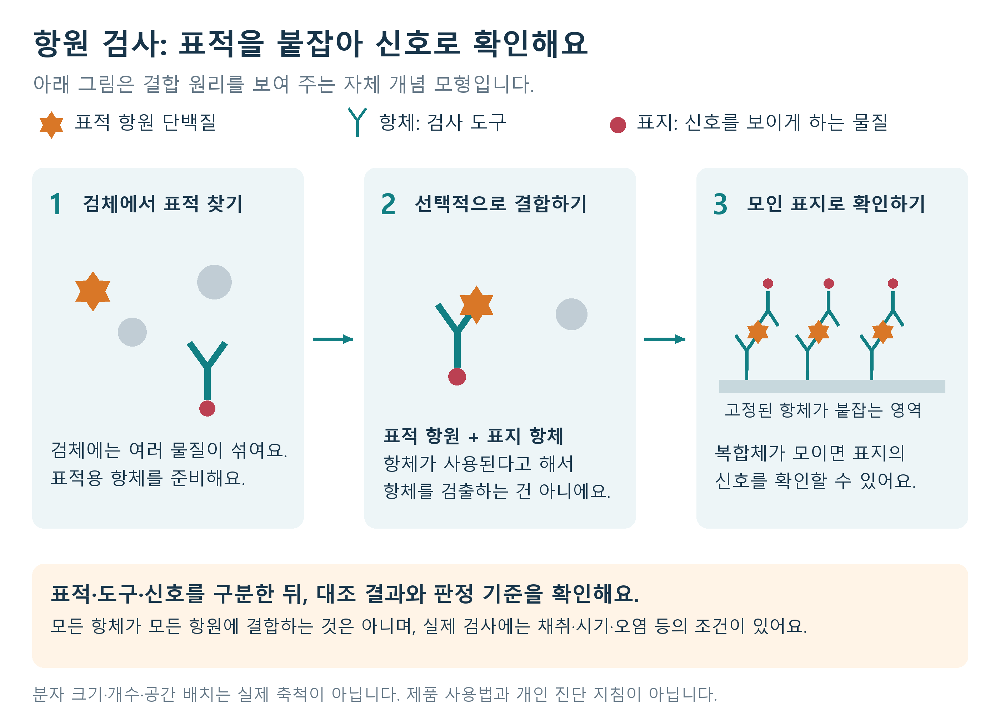
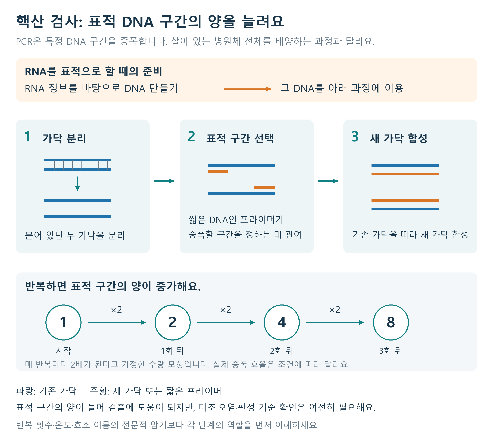
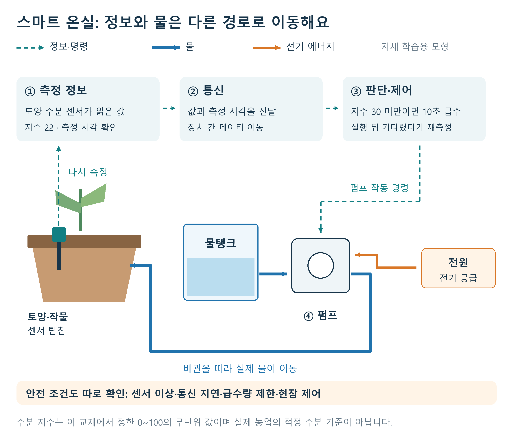

# 통합과학2 · 과학과 미래 사회

과학기술의 이름을 아는 데서 한 걸음 더 나아가 봐요. 검사가 무엇을 검출하는지, 많은 자료가 어떤 결론을 지지하는지, 편리한 기술을 어떤 조건에서 믿을 수 있는지 판단하는 힘을 기르는 장이에요. 미래 사회 문제에서는 과학적 근거와 사람들의 가치가 함께 등장해요. 둘을 구별하면서도 함께 고려할 수 있어야 해요.

각 소단원은 선개념 → 개념 → 개념평가 → 심화개념 → 심화평가 → 수능대비 전략 → 수능대비평가로 이어져요. 정의·조건·문항은 정확히 읽고, 설명과 힌트를 따라 자신의 말로 이유를 만들어 보세요. 이 장의 평가는 모두 새로 출제한 연습문항이며 자료는 학습을 위한 가상 자료이다. 수능대비평가는 공식 수능·평가원 문항과 구별된다. 감염병 사례의 수치와 검사 규칙은 문제 풀이를 위한 조건이며 실제 개인의 진단 지침이 아니다.

## 01 감염병의 진단·추적과 과학의 유용성 [10통과2-03-01]

### 1. 선개념

**T2-03-01-P1.** 감염병을 일으키는 병원체와 병원체를 다른 숙주에게 옮기는 매개체는 같은 개념인가? 감염된 모기가 병원체를 옮기는 경우 모기는 어느 쪽인가?

**T2-03-01-P2.** DNA·RNA와 단백질은 모두 같은 물질인가? 유전 정보를 저장·전달하는 물질과 다양한 생명 활동의 기능을 수행하는 물질을 연결하시오.

병원체는 감염병을 일으키는 바이러스·세균 등이고, 매개체는 병원체를 전달하는 역할을 하는 생물이에요. 모기가 어떤 병원체를 옮긴다고 해서 그 모기 자체와 병원체가 같은 것은 아니에요. 모든 감염병이 모기를 통해 전파되는 것도 아니에요. 문제에 제시된 전파 경로를 확인해야 해요.

DNA·RNA는 핵산이고 단백질과는 다른 물질이에요. 핵산에 담긴 염기서열 정보와 단백질의 구조·기능은 연결되지만 검출 대상은 구별할 수 있어요. 감염병 검사에서도 특정 병원체의 핵산을 찾는 방법과 특정 단백질을 찾는 방법을 나누어 생각하면 이해하기 쉬워요.

### 2. 개념

**감염병의 진단**은 검사와 관찰 등으로 감염 여부를 판단하는 과정이에요. **추적**은 발생 시기·장소·접촉 등의 자료에서 전파 경로와 관련 집단을 파악하는 과정이에요. **예측**은 관측된 관계와 모형을 이용하여 앞으로의 발생 가능성이나 시기 등을 추론하는 일이에요. 검사 하나가 이 세 가지 역할을 모두 완벽하게 수행하는 것은 아니에요.

#### 단백질을 이용하는 검사

**항원:** 면역 반응의 표적이 될 수 있는 물질. **항체:** 특정 항원에 결합하는 성질을 가진 단백질.

항원-항체 결합의 특이성을 이용하면 검체 속 특정 병원체 단백질을 찾을 수 있어요. 예를 들어 검사 장치에 준비된 항체가 병원체의 특정 단백질과 결합하면 신호가 나타나도록 만들 수 있죠. ‘항체를 사용한다’는 말과 ‘사람의 항체를 검출한다’는 말은 같지 않아요. **검사에 쓰는 도구**가 무엇인지와 **검체에서 찾는 표적**이 무엇인지를 구별하세요.

사람이 만들어 낸 항체를 검출하는 검사도 있을 수 있어요. 따라서 단백질 검사라는 표현만 보고 무조건 현재 병원체 자체를 직접 검출한다고 말하면 안 돼요. 문제에서 검출 대상을 확인해야 해요.

#### 핵산을 이용하는 검사

병원체의 특징적인 염기서열을 찾으면 병원체를 구별하는 단서가 돼요. 핵산이 적어 바로 검출하기 어려울 때 특정 부분을 증폭하여 확인하는 방법을 이용할 수 있어요. PCR은 DNA의 특정 부분을 증폭하는 기술이에요. RNA를 표적으로 하는 경우에는 RNA를 DNA로 바꾸는 과정 등을 거쳐 증폭하는 방법을 사용할 수 있어요. 이 단원에서는 효소 이름과 온도 단계를 모두 암기하기보다 **표적 핵산 → 필요한 전처리 → 증폭 → 신호 확인**의 역할을 이해하면 돼요.

증폭한다는 말은 병원체를 일부러 살아서 많이 기른다는 뜻이 아니에요. 핵산의 특정 부분을 복제하여 양을 늘리는 과정과 살아 있는 병원체 전체를 배양하는 과정은 구별해요.

| 구분 | 특정 항원 단백질 검출의 예 | 핵산 증폭 검출의 예 |
|---|---|---|
| 검체에서 찾는 대상 | 특정 단백질 | 특정 핵산 서열 |
| 핵심 원리 | 항원-항체의 선택적 결합 | 표적 서열의 증폭·검출 |
| 판단할 때 볼 것 | 신호가 무엇과 결합하여 생기는가 | 무엇을 증폭하고 있는가 |
| 공통으로 필요한 점 | 적절한 검체·검사 시기·대조·판정 기준 | 적절한 검체·검사 시기·대조·판정 기준 |

방법의 이름만으로 모든 상황에서 정확성이 같거나 어느 한 방법이 무조건 우수하다고 말할 수는 없어요. 표적의 양, 검체 채취 상태, 오염, 검사 시점 등 조건이 결과에 영향을 줄 수 있기 때문이에요.

#### 감염병 추적: 검사 결과에 시간과 접촉을 연결해요

진단이 ‘이 사람에게서 표적이 검출되었는가’를 묻는다면, 추적은 ‘어떤 접촉과 시점이 전파 경로의 후보가 되는가’를 묻는 과정이에요. 두 사람이 같은 날 양성이라고 해서 같은 날 감염되었거나 한쪽이 다른 쪽에 전파했다고 확정할 수는 없어요. 검사를 받은 날과 감염된 날은 서로 다를 수 있기 때문이에요.

연습을 위해 **가상 감염병 모형**을 사용해 볼게요. 아래 기간은 실제 감염병의 기준이 아니라 문제에서 정한 규칙이에요.

- 감염일부터 증상 발생일까지의 날짜 차이는 2~4일이다.
- 다른 사람에게 전파할 수 있는 기간은 증상 발생일의 2일 전부터 증상 발생일까지이다. 기간의 양 끝 날짜를 포함한다.
- 접촉이 있어도 반드시 전파되는 것은 아니다. 기록되지 않은 접촉이나 공통 감염원이 있을 수 있다.

| 익명 인물 | 증상 발생일 | 검사일·결과 | 확인된 접촉 |
|---|---|---|---|
| A | 6일 | 10일·양성 | 5일에 B, 6일에 C와 접촉 |
| B | 9일 | 10일·양성 | 5일에 A와 접촉 |
| C | 7일 | 10일·양성 | 6일에 A와 접촉 |

**1단계는 날짜를 계산하는 거예요.** B가 9일에 증상이 생겼다면 감염 가능 날짜는 9−4=5일부터 9−2=7일까지예요. A가 전파할 수 있는 기간은 6−2=4일부터 6일까지예요. 두 기간에 공통으로 들어가는 5일에 실제 접촉 기록이 있어요. 따라서 **5일의 A→B 전파는 이 모형의 시간 조건에 맞는 후보**가 돼요.

**2단계는 조건에 맞지 않는 접촉을 구별하는 거예요.** C의 감염 가능 날짜는 7−4=3일부터 7−2=5일까지예요. A와 C의 확인된 접촉은 6일이므로, 이 접촉으로 C가 감염되어 7일에 증상이 생겼다는 설명은 주어진 2~4일 조건과 맞지 않아요. ‘접촉 기록이 있다’는 사실만으로 가능한 경로라고 정할 수 없다는 뜻이에요.

**3단계는 후보와 확정을 구별하는 거예요.** A→B가 시간 조건에 맞아도 B가 다른 사람이나 공통 장소에서 감염되었을 가능성이 남아요. 추가 접촉·방문 시점, 검사 시점과 검체 정보, 필요한 경우 병원체 특성 등의 자료를 함께 검토해야 해요. 먼저 증상이 생긴 사람이 언제나 최초 감염자라는 규칙도 없어요. 감염 후 증상까지의 기간이 사람마다 다를 수 있기 때문이에요.

추적에 필요한 정보를 수집할 때는 목적에 필요한 접촉·시점 정보를 중심으로 살펴봐요. 여기서 이름을 A·B·C로 표시한 것처럼 학습과 분석에는 익명 표시를 활용할 수 있어요. 모든 이동 경로와 개인 정보를 널리 공개할수록 더 과학적인 추적이 되는 것은 아니에요. 필요한 정보와 공개 범위를 구분하는 일도 기술 활용의 일부예요.

#### 검체·표적·검사 도구를 한 줄씩 분리해요

**검체**는 검사하려고 사람이나 환경 등에서 채취한 물질이에요. 검체 안에는 찾으려는 표적 이외의 물질도 섞여 있을 수 있어요. 특정 표적을 선택하는 과정과 그 표적이 있다는 사실을 눈이나 장치로 확인할 신호로 바꾸는 과정이 모두 필요해요. 다음 표는 장치의 구체적인 제품 구조가 아니라 기능을 단계로 풀어 쓴 모형이에요.

| 단계 | 항원 단백질을 찾는 검사 모형 | DNA의 특정 부분을 찾는 검사 모형 |
|---|---|---|
| 1. 시료 준비 | 검체에서 단백질 표적을 검사 가능한 상태로 준비 | 검체에서 핵산을 검사 가능한 상태로 준비 |
| 2. 표적 선택 | 표적 항원에 결합하는 항체 이용 | 찾을 DNA 서열에 맞는 증폭 조건 이용 |
| 3. 검출 가능하게 하기 | 결합 여부가 색 등의 신호로 이어지게 함 | 표적 부분을 여러 차례 복제하여 양을 늘림 |
| 4. 유효성·판정 | 대조와 정한 판정 기준을 확인 | 대조와 정한 판정 기준을 확인 |

항체가 특정 항원에 선택적으로 결합한다는 말은 모든 항체가 모든 단백질에 똑같이 달라붙는다는 뜻이 아니에요. 반대로 특이성이 있다는 사실이 실제 검사에서 오염이나 비특이적 반응이 원리적으로 불가능하다는 뜻도 아니에요. 표적이 검체에 너무 적거나 채취가 충분하지 않으면 신호가 기준보다 작게 나올 수 있고, 오염으로 표적이 섞이면 원래 검체의 상태와 다른 신호가 나올 수 있어요. 그래서 표적·도구·신호·판정 기준을 구별해야 해요.

DNA 증폭에서는 원하는 구간을 포함한 DNA의 양을 늘려요. RNA를 표적으로 하는 검사라면 먼저 RNA 정보를 이용해 DNA를 만드는 과정이 필요할 수 있어요. 두 방법 모두 사람 몸속에서 병원체를 키우는 과정으로 설명하지 않아요. 바이러스의 유전 물질이 검출되었다는 사실과 살아 있는 바이러스의 수를 직접 센 결과도 같은 측정이 아니에요.

#### 항원 검사: 결합한 뒤 무엇이 모여서 보일까요?

**표지**는 결합이 일어났는지를 확인할 수 있도록 붙이는 신호 물질이에요. 아래 모형에서 주황색 별은 찾을 항원 단백질, 청록색 Y는 그 항원에 결합하는 항체, 붉은 점은 눈에 보이는 신호를 만드는 표지예요. 별과 Y의 크기·모양은 역할을 구별하기 위한 표현이며 실제 분자의 축척은 아니에요.

**그림 읽기:** 먼저 표적 항원이 표지가 붙은 항체와 결합해요. 이것이 이동하여 고정된 항체가 있는 영역에 붙잡히면 표지도 그곳에 모여요. 적절한 조건에서 모인 표지의 색 등을 확인하는 것이 검출 신호예요. 표적을 붙잡는 기능과 결과를 보이게 하는 기능을 나누어 생각하면 돼요. 항체가 도구로 사용되어도 이 검사에서 찾는 대상은 항원이에요. 이 그림은 표지 항체와 포획 항체를 사용하는 방식의 원리를 단순화한 것이며 모든 면역 검사의 구조가 같다는 뜻은 아니에요. 원리 확인 자료: [FDA에 공개된 제조사 검사 설명서의 Principle of Procedure, PDF 3쪽](https://www.fda.gov/media/145697/download).

여기서 **검사 영역에 나타나는 신호**와 **장치가 작동했는지를 확인하는 대조 신호**를 구별해야 해요. 검사 영역에서 신호가 안 보인 이유가 표적이 적기 때문인지, 장치의 이동·반응 과정이 작동하지 않았기 때문인지 한 장면만으로는 구별하기 어려워요. 대조 신호는 후자를 점검하는 데 쓰여요. 다만 대조 신호가 정상이어도 검체 채취가 완벽했다는 사실까지 보장하는 것은 아니에요. 다음 심화개념에서 배울 별도의 양성·음성 대조 시료와 장치 안의 작동 확인 신호도 같은 물건은 아니므로 제시문이 어떤 대조를 말하는지 읽어야 해요.

**완결 예 — 표적, 도구, 신호를 서로 다른 칸에 써 봐요.** 가상 병원체의 단백질 X를 찾는 검사에서, 항체 Y에는 붉은 표지가 붙어 있어요. 검체의 X가 Y에 결합하고, 그 복합체가 검사 영역에 모였어요. 이때 ‘찾으려는 물질’은 X, ‘찾는 데 이용한 단백질’은 Y, ‘눈으로 확인하는 현상’은 표지가 모여 나타나는 색이에요. “항체가 쓰였으므로 환자의 항체가 검출되었다.”라고 답하면 도구를 표적으로 바꾼 것이에요. “붉은색이 보였으므로 병원체의 수가 정확히 100개이다.”라고 답해도 근거가 없어요. 이 자료에는 색과 개수를 연결하는 수치 기준이 없기 때문이에요.

**중간 확인 — 항체라는 단어가 나오면 무엇을 먼저 물을까요?** 답을 보기 전에 ‘검체에서 찾는 항체인가, 장치에 준비된 항체인가’를 구별해 보세요. **확인 답:** 준비된 항체로 X를 찾는 이 모형의 표적은 X예요. 항체라는 단어 하나로 검출 대상을 결정하면 안 돼요. 또한 작동 확인 신호가 실패했다면 검사 영역만 보고 유효한 결과라고 해석할 수 없어요.

#### 핵산 검사: 필요한 구간을 선택하고 반복해 양을 늘려요

DNA는 두 가닥이 서로 짝을 이루는 구조예요. PCR에서는 먼저 두 가닥을 분리하고, 각 가닥을 바탕으로 새 가닥을 합성해요. **프라이머**는 새 DNA 합성을 시작할 위치에 결합하는 짧은 DNA예요. 증폭하려는 구간의 양쪽을 정하는 데 이용하므로, 검체 속 모든 DNA를 무조건 같은 정도로 늘리는 것으로 이해하면 안 돼요. 이 단원에서는 이름을 더 많이 외우기보다 ‘구간 선택’과 ‘새 가닥 합성’이 다른 역할이라는 점을 파악하세요. [NHGRI의 PCR 용어 설명](https://www.genome.gov/genetics-glossary/Polymerase-Chain-Reaction-PCR?id=159).

그림의 첫 번째 칸에서 분리된 기존 가닥은 없어지는 것이 아니라 새 가닥을 만드는 바탕으로 쓰여요. 두 번째 칸에서는 표적 구간에 맞는 프라이머가 결합하고, 세 번째 칸에서는 DNA를 합성하는 효소가 기존 가닥의 정보를 따라 새 가닥을 만들어요. 만들어진 DNA도 다음 반복의 바탕이 될 수 있어 양이 증가해요. **DNA 한 가닥을 길게 늘이는 것과 표적 구간을 포함한 DNA의 수를 늘리는 것은 다른 설명**이에요. PCR 증폭에서는 후자를 생각해야 해요. 가닥 분리와 합성이 반복되는 원리는 [NHGRI의 PCR 설명 자료](https://www.genome.gov/about-genomics/fact-sheets/Polymerase-Chain-Reaction-Fact-Sheet)로 확인했어요.

검사하려는 유전 물질이 RNA라면 준비 단계가 하나 더 필요해요. 여기서 다루는 RT-PCR 방식은 RNA의 정보를 바탕으로 대응하는 DNA를 만든 뒤 그 DNA를 증폭해요. 이를 **역전사**라고 해요. RNA가 단백질로 바뀐 다음 단백질을 복제한다는 과정이 아니에요. 표적의 출발 물질이 RNA라는 사실과 PCR에서 직접 늘리는 물질이 DNA라는 사실을 함께 말할 수 있어야 해요. [NCI의 역전사 중합효소 연쇄 반응 정의](https://www.cancer.gov/publications/dictionaries/cancer-terms/def/reverse-transcription-polymerase-chain-reaction).

**완결 예 — 반복에 따라 늘어나는 양을 읽어 봐요.** 계산을 위해 ‘시작할 때 목표 DNA의 양이 3단위이고, 매 반복 뒤 정확히 2배가 된다’는 가상 모형을 정할게요. 여기서 단위는 개수를 실제로 측정한 임상 단위가 아니라 상대적인 양의 단위예요.

| 반복 횟수 | 시작 | 1회 뒤 | 2회 뒤 | 3회 뒤 |
|---|---:|---:|---:|---:|
| 표적 DNA의 상대량 | 3 | 6 | 12 | 24 |
| 바로 앞 단계와의 관계 | 기준 | 3×2 | 6×2 | 12×2 |

3회 뒤 양은 시작의 24÷3=8배예요. 매번 3을 더한 3→6→9→12가 아니라, **직전 단계의 양에 2를 곱한 결과**라는 점을 확인하세요. 이 계산은 모든 실제 검사에서 정확히 2배씩 증가한다는 법칙이 아니에요. 문제에서 준 이상적인 증가 조건을 적용한 결과이고, 실제 증폭 효율은 반응 조건 등에 따라 달라요. 양이 늘었다는 사실만으로 오염이나 대조 확인이 불필요해지는 것도 아니에요.

**중간 확인 — 세 문장을 판정해 봐요.** ㉠ PCR은 표적 단백질을 늘린다. ㉡ 여기서 설명한 RNA 검사는 RNA 정보로 DNA를 준비한 뒤 DNA를 증폭한다. ㉢ 표적 DNA가 늘면 살아 있는 병원체 전체도 그 배수만큼 늘어난 것이다. **확인 답:** ㉠은 틀려요. PCR의 직접 증폭 대상은 DNA예요. ㉡은 맞아요. 준비와 증폭을 나누어 읽었어요. ㉢은 틀려요. 특정 유전 물질의 증폭과 병원체 전체의 배양은 서로 다른 과정이에요.

**자료·도해 기록:** 위 두 그림은 공개자료 검증 후 자체 집필·도해한 자료예요. 외부 그림의 픽셀·배치를 옮기지 않고 표적·도구·신호와 가닥 분리·선택·합성의 관계를 새로 구성했어요. 검증 자료 확인일은 2026년 10월 17일이에요. 수정 가능한 SVG와 재구성 지시문은 함께 제공하는 도해 기록에 보존했어요.

**도해 재구성 지시문 — SCI-AUTH-01:** 흰 배경, 청록색 항체, 주황색 항원, 붉은 표지를 사용한다. 검체→표지 항체와 항원의 결합→고정된 포획 항체에 복합체가 모이는 세 단계를 큰 한글 라벨로 그린다. 검사 표적·도구·검출 신호를 구별하고, 분자 크기와 개수는 축척이 아님을 명시한다. 특정 제품의 사용법이나 실제 진단 판정 시간은 그리지 않는다. 기존 교과서 그림을 변형하는 작업이 아니라 공개된 원리로 새로 구성한 도해이다.

**도해 재구성 지시문 — SCI-AUTH-02:** RNA 정보로 DNA를 준비하는 보충 경로 위에, DNA 가닥 분리→프라이머를 통한 구간 선택→새 가닥 합성의 세 단계를 그린다. 기존 가닥은 파랑, 프라이머·새 가닥은 주황으로 통일한다. 1→2→4→8은 매회 두 배를 가정한 수량 모형임을 표시한다. DNA 증폭을 병원체 전체 배양으로 그리지 않는다. 특정 교과서 도판을 복제하거나 변형한 그림이 아니다.

### 3. 개념평가

**T2-03-01-C1.** 검사 A는 검체 속 특정 병원체 단백질을 준비된 항체에 결합시켜 신호를 낸다. 검출 표적과 검사에 이용하는 결합 원리를 쓰시오.

**T2-03-01-C2.** 검사 B는 병원체의 특정 DNA 부분을 증폭하여 확인한다. B가 직접 증폭하는 대상은 단백질·핵산·모기 중 무엇인가?

**T2-03-01-C3.** “한 번의 음성 결과는 검사 시점·채취 상태와 무관하게 감염 가능성이 항상 0임을 뜻한다.”라는 주장을 평가하시오.

### 4. 심화개념

#### 대조 시료는 결과를 해석할 수 있는지 확인한다

**양성 대조**는 표적이 들어 있음을 아는 시료예요. 검사가 표적을 검출할 수 있는지 확인하는 데 이용해요. **음성 대조**는 표적이 없도록 준비한 시료예요. 원래 없어야 할 신호가 생기는지 확인하여 오염·비특이적 반응 등의 가능성을 점검해요.

미지 검체에 신호가 나왔다고 바로 결론을 내리기 전에 대조 결과를 읽어야 해요. 양성 대조에서 신호가 안 나오면 검출 과정이 제대로 작동했는지 의심해야 하고, 음성 대조에서 신호가 나오면 오염 등으로 해석이 흔들릴 수 있어요. ‘검체의 값이 기준보다 크다’는 계산과 ‘그 검사 결과를 신뢰할 수 있다’는 판단은 두 단계예요.

#### 검사 결과 표는 기준 집단부터 읽는다

가상 검사 결과가 다음과 같다고 해 봐요. 별도 기준 검사로 감염 여부가 확인된 200명을 같은 조건에서 검사한 자료예요.

| 실제 상태 | 이 검사 양성 | 이 검사 음성 | 합계 |
|---|---:|---:|---:|
| 감염 확인 | 80 | 20 | 100 |
| 비감염 확인 | 10 | 90 | 100 |

감염이 확인된 100명 중 양성이 80명이므로 ‘감염자 중 양성인 비율’은 80%예요. 하지만 전체 양성 90명 중 감염자는 80명이므로 ‘양성자 중 감염자인 비율’은 80/90이에요. 둘은 분모가 달라요. 어려운 확률 공식을 쓰기 전에 문장의 ‘중’을 찾아 표에서 전체 집단을 정하면 돼요. 이 표의 비율을 다른 집단에 무조건 그대로 옮길 수도 없어요. 검사 성능과 검사받는 집단의 감염 분포가 달라질 수 있기 때문이에요.

#### 발생 조건을 새 자료에 옮긴다

어떤 매개체 관련 감염병의 과거 자료에서 특정 기온 조건과 발생 시기가 함께 관측되었다면 예측에 활용할 수 있어요. 이때 최고 기온·최저 기온·평균 기온 중 무엇인지, 임계값 ‘이상’인지 ‘초과’인지 읽어야 해요. 관측된 관련성이 다른 조건에서도 반드시 같은 인과 관계를 보장하지는 않으므로, 예측에는 적용 조건과 불확실성을 붙여요. 과학의 유용성은 완벽한 예언이 아니라 관측과 검증으로 판단의 근거를 개선하는 데에도 있어요.

#### 관측으로 규칙을 고른 다음 새 자료에 적용해요

가상 자료에서 매개체가 나타나기 시작하는 시점을 설명할 후보가 ‘최고 기온이 15℃ 이상’과 ‘최저 기온이 15℃ 이상’ 두 가지라고 해 봐요. 이 후보와 임계값은 연습에서 주어진 조건이에요.

| 가상 관측 월 | 2월 | 3월 | 4월 |
|---|---:|---:|---:|
| 최고 기온 | 18℃ | 21℃ | 24℃ |
| 최저 기온 | 8℃ | 12℃ | 16℃ |
| 매개체 관측 수 | 0 | 0 | 8 |

최고 기온은 2월에도 15℃ 이상이지만 그때 매개체는 관측되지 않았어요. 따라서 제시한 두 후보 중 ‘최고 기온 기준’은 발생 시작 시점과 맞지 않아요. 최저 기온이 15℃ 이상을 처음 만족하는 4월은 발생 시작과 맞으므로, 주어진 후보 중에서는 최저 기온 기준이 자료에 더 잘 맞아요. 이 한 표로 가능한 모든 온도 기준이나 다른 환경 요인을 배제하여 유일한 자연 법칙을 증명했다는 뜻은 아니에요.

새해의 예측표가 주어지면 이제 선택한 최저 기온 행에서 기준을 처음 만족하는 시점을 찾아요. 과거 자료에서 규칙을 찾는 단계와 새 자료에 그 규칙을 적용하는 단계를 구별해야 해요. 발생 시점이 달라졌다는 결론을 쓰기 전에 새 자료도 같은 지표·기간 단위로 표현되었는지 확인해요.

#### 분모가 달라지면 같은 사람을 세어도 비율이 달라져요

감염 확인자 중 검사 양성의 비율을 구할 때는 실제 감염 확인자 행 전체를 분모로 삼아요. 양성자 중 감염 확인자의 비율을 구할 때는 양성 열 전체가 분모예요. 한쪽은 이미 감염 상태를 아는 사람들의 검사 결과이고 다른 쪽은 양성 결과를 받은 사람들의 실제 상태이므로 질문의 출발 집단이 달라요. 따라서 ‘감염자 80% 검출’이라는 말만으로 ‘양성자의 80%가 감염’이라고 바꾸어 말할 수 없어요. 이러한 분모 해석은 제시한 자료의 읽기 연습이며 실제 진단 확률을 스스로 판정하도록 하는 지침은 아니에요.

### 5. 심화평가

**T2-03-01-A1.** 가상 검사에서 신호 5 이상을 양성으로 판정하며, 양성 대조는 5 이상, 음성 대조는 5 미만이어야 검사 묶음이 유효하다. 양성 대조 8, 음성 대조 7, 미지 검체 9가 나왔다. 미지 검체를 확정 양성으로 보고할 수 있는가? 근거를 쓰시오.

**T2-03-01-A2.** 위 200명 검사표에서 ① 감염 확인자 중 음성인 비율 ② 전체 양성자 중 비감염 확인자의 비율을 구하시오. 두 계산의 분모가 다른 이유도 쓰시오.

**T2-03-01-A3.** 다음은 가상 감염병의 접촉 기록이다. 감염일부터 증상 발생일까지의 날짜 차이는 2~4일이며, 전파 가능 기간은 증상 발생일의 2일 전부터 증상 발생일까지이다. 양 끝 날짜를 포함한다. 접촉해도 전파되지 않을 수 있고 미기록 접촉도 있을 수 있다. 세 사람은 모두 12일의 검사에서 양성이었다.

| 익명 인물 | 증상 발생일 | 확인된 접촉 |
|---|---|---|
| D | 8일 | 7일에 E와 접촉 |
| E | 11일 | 7일에 D, 9일에 F와 접촉 |
| F | 10일 | 9일에 E와 접촉 |

① E와 F의 감염 가능 날짜 범위를 각각 구하시오. ② ‘7일 D→E’와 ‘9일 E→F’ 중 주어진 시간 조건에 맞는 전파 경로 후보를 고르고 이유를 쓰시오. ③ 시간 조건에 맞는 후보가 실제 전파 경로로 확정되는지 판단하고, 추가로 확인할 자료 한 가지를 쓰시오.

### 6. 수능대비 전략

이 단원에서 왜 낯선 검사 절차를 길게 제시할까요? 전문 기술 이름을 아는지보다 **표적·절차·대조·판정의 관계를 이해하는지**를 확인할 수 있기 때문이에요. 처음에는 ‘무엇을 찾는 검사인가’를 표시하고, 다음에는 대조 조건이 충족되는지 확인해요. 그 뒤에 미지 검체를 판정해요.

발생 예측 자료는 과거 자료에서 조건을 먼저 찾고, 같은 종류의 지표로 새 자료를 읽어요. 최저 기온으로 만든 규칙을 최고 기온 그래프에 적용하면 안 돼요. 수치표에서는 ‘감염자 중’과 ‘양성자 중’의 분모를 분리하세요. 음성=절대 비감염, 양성=어떤 조건에서도 확정이라는 단정이 반례를 갖는지 생각해 봐요.

추적 자료에서는 **전파한 후보의 전파 가능 기간, 전파받은 후보의 감염 가능 기간, 실제 접촉 날짜**를 각각 적어 겹치는지 확인해요. 세 조건이 맞으면 후보가 되지만, 다른 경로가 배제되지 않았다면 확정이라고 쓰지 않아요. 검사일·증상일·감염일을 같은 날짜로 바꾸어 읽지 않는 것이 첫 단계예요.

### 7. 수능대비평가

**T2-03-01-S1.** 가상 검사 A는 병원체의 특정 단백질을 항체로 검출하고, B는 특정 DNA 부분을 증폭하여 검출한다. 옳은 설명은?

① A는 검체의 DNA를 증폭한다. ② A가 항체를 이용하므로 검출 표적은 반드시 사람의 항체이다. ③ B는 핵산을 이용하는 진단 기술이다. ④ B는 살아 있는 병원체 전체만을 배양하는 기술이다. ⑤ 두 검사 모두 대조 시료와 검사 조건을 확인할 필요가 없다.

**T2-03-01-S2.** 한 교육용 예측 모형은 ‘월 최저 기온이 처음 15℃ 이상이 되는 달’을 매개체 활동 시작 예상 달로 정한다. 다른 조건은 같다고 가정한다. 아래 예측 기온에서 모형이 예상하는 달은?

| 월 | 3월 | 4월 | 5월 | 6월 | 7월 |
|---|---:|---:|---:|---:|---:|
| 월 최고 기온 | 18℃ | 22℃ | 25℃ | 28℃ | 30℃ |
| 월 최저 기온 | 7℃ | 12℃ | 15℃ | 18℃ | 21℃ |

① 3월 ② 4월 ③ 5월 ④ 6월 ⑤ 7월

### 정답과 해설

- **P1:** 다른 개념이며, 제시된 모기는 매개체이다. 질병의 원인과 전달 역할을 나눠요. 돌아갈 개념: 병원체·매개체.
- **P2:** 다르다. DNA·RNA는 핵산이며 유전 정보와 연결되고, 단백질은 다양한 생명 기능을 수행한다. 유전 정보가 단백질 합성과 연결된다는 사실과 물질 자체가 같다는 주장은 달라요. 돌아갈 개념: 핵산과 단백질.
- **C1:** 병원체의 특정 단백질, 항원-항체의 선택적 결합. 도구로 사용한 항체를 검출 대상으로 바꾸지 마세요. 돌아갈 개념: 표적과 도구의 구별.
- **C2:** 핵산. DNA의 특정 부분을 늘리는 것이지 단백질이나 매개체를 증폭하는 것이 아니에요. 돌아갈 개념: 핵산 증폭.
- **C3:** 타당하지 않다. 표적량·시기·채취 상태 등에 따라 감염되어도 음성이 나올 수 있어요. 이 문항은 실제 개인의 감염 여부를 판단하라는 문제가 아니라 보편적 단정의 한계를 찾는 문제예요. 돌아갈 개념: 검사 결과의 조건.
- **A1:** 확정할 수 없다. 음성 대조 7이 기준 5 이상이어서 유효 조건을 위반했어요. 검체 9만 비교하지 말고 먼저 대조 결과로 검사 묶음의 유효성을 판단해요. 돌아갈 개념: 음성 대조.
- **A2:** ① 20/100=20%. ② 10/(80+10)=1/9, 약 11.1%. 첫 집단은 감염 확인자이고 둘째는 검사 양성자여서 분모가 달라요. 돌아갈 개념: 조건에 따른 비교 집단.
- **A3:** ① E는 11−4=7일부터 11−2=9일까지, F는 10−4=6일부터 10−2=8일까지예요. ② D의 전파 가능 기간은 6~8일이고 E의 감염 가능 기간은 7~9일이므로 7일 D→E는 후보가 돼요. E의 전파 가능 기간은 9~11일이지만 F의 감염 가능 기간은 6~8일이므로, 9일 E→F는 F의 증상 시점과 맞지 않아요. 접촉한 9일에서 증상일 10일까지는 1일밖에 지나지 않았기 때문이에요. ③ D→E도 확정할 수 없어요. E의 다른 접촉이나 공통 장소 방문 시점, 미기록 감염원 등을 추가로 조사할 수 있어요. **풀이 순서:** 증상일에서 4일·2일을 빼 감염 기간 작성 → 전파자 기간 작성 → 접촉 날짜와 대조 → 후보와 확정 구분. 오답 원인: 12일 양성 검사일을 감염일로 사용하거나 접촉 사실만으로 전파를 확정함. 돌아갈 개념: 감염병 추적의 세 가지 시간 조건.
- **S1: ③.** ① A의 표적은 단백질이에요. ② 항체가 도구로 쓰였으며 표적은 병원체 단백질이에요. ③ B가 DNA를 증폭하므로 맞아요. ④ 특정 DNA 증폭과 병원체 전체 배양은 달라요. ⑤ 검사의 유효성과 신뢰성을 위해 조건 확인이 필요해요. **풀이 순서:** 검사별 표적을 먼저 적고 절차를 연결해요. 돌아갈 개념: 단백질 검사와 핵산 검사.
- **S2: ③.** ① 3월의 최저 기온은 7℃라 조건을 충족하지 않아요. ② 4월은 12℃예요. ③ 5월은 15℃로 ‘이상’을 처음 충족해요. ④ 6월도 충족하지만 처음이 아니에요. ⑤ 7월도 처음이 아니에요. **풀이 순서:** 최저 행 선택 → 15 이상 표시 → 가장 이른 달 선택. 오답 원인: 최고 기온 사용, ‘이상’을 ‘초과’로 읽음, ‘처음’ 누락. 돌아갈 개념: 예측 조건의 정확한 적용.

## 02 빅데이터의 활용과 한계 [10통과2-03-02]

### 1. 선개념

**T2-03-02-P1.** 세 번 측정한 온도가 20℃, 22℃, 24℃이다. 평균을 구하시오.

**T2-03-02-P2.** ‘기온이 높은 날 아이스크림 판매량과 물놀이 사고가 함께 증가했다’는 관측만으로 아이스크림이 사고의 원인이라고 확정할 수 있는가?

평균은 합을 자료 수로 나눈 값이에요. 평균을 구하면 여러 값을 한 값으로 요약할 수 있지만 분포와 극단값 정보가 줄어들 수 있어요. 또 두 값이 함께 변하는 관계를 **상관관계**라고 할 수 있지만, 한쪽이 다른 쪽의 원인이라는 **인과관계**와 같지는 않아요. 공통으로 영향을 주는 다른 요인이 있을 수 있기 때문이에요.

### 2. 개념

**빅데이터:** 크기·종류·생성 속도 등의 특성으로 기존의 단순한 처리만으로 다루기 어려운 방대한 데이터와 그 활용을 가리키는 개념.

기상 관측소·인공위성·실험 장치·생활 속 센서는 여러 종류의 자료를 계속 만들어요. 이를 모아 규칙을 찾으면 일기 예보, 환경 감시, 유전체 분석, 신약 후보 탐색, 감염병 발생 추정 등 과학기술과 사회 문제 해결에 활용할 수 있어요. 자료를 모은다는 사실만으로 답이 자동으로 생기는 것은 아니에요. 어떤 질문에 답할 것인지와 자료의 의미를 정해야 해요.

| 과정 | 하는 일 | 점검할 문제 |
|---|---|---|
| 수집 | 목적에 맞는 자료 확보 | 누구·어디·언제가 빠졌는가 |
| 정제 | 오류·중복·결측·형식 문제 처리 | 정당한 기준 없이 불리한 값을 삭제하지 않았는가 |
| 변환·통합 | 단위·시간·표현을 맞추고 연결 | ℃와 다른 온도 단위, 서로 다른 시간대를 섞지 않았는가 |
| 분석 | 평균·변화·상관 등 패턴 조사 | 비교 집단과 분모가 적절한가 |
| 해석·활용 | 근거 범위 안에서 판단·예측 | 상관을 인과로 바꾸거나 적용 범위를 넘지 않았는가 |

**결측값**은 측정값이 없다는 뜻이에요. 측정하지 못한 강수량을 마음대로 0 mm로 바꾸면 ‘비가 오지 않았다’는 관측을 만들어 내는 셈이에요. **이상값**은 다른 값들과 크게 다른 값이지만 반드시 오류는 아니에요. 센서 고장일 수도 있고 실제 극단 현상일 수도 있으므로 원인을 확인해야 해요. 정제는 보기 좋은 결과를 만드는 과정이 아니라 분석에 필요한 자료의 신뢰성을 높이는 과정이에요.

#### 자료 한 행이 무엇을 뜻하는지 먼저 정해요

한 행이 ‘한 사람의 하루 측정’인지 ‘한 센서의 한 시각 측정’인지 다르면 같은 1만 행도 의미가 달라요. 수집 과정에서 같은 관측을 여러 번 저장하면 행 수는 늘지만 새로운 측정을 한 것은 아니에요. **중복 저장은 독립적인 새 관측을 추가하지 않는다.** 기온 20℃를 한 번 측정해 100번 복사했다고 100번 반복 측정한 결과가 되지 않아요. 분석 전에 관측 대상·시각·장치 등의 식별 기준으로 같은 기록인지 확인하는 이유예요.

단위를 통일할 때는 수치까지 그 단위에 맞춰 바꿔요. 1 m와 100 cm는 같은 길이인데 단위만 지우면 1과 100이 서로 다른 길이처럼 보여요. 시각도 같은 시점을 가리키는지 맞춰야 하고, 하루 평균과 순간 측정값은 단위가 같아도 집계 방식이 달라요. 자료를 합쳤다는 이유만으로 서로 같은 조건의 관측이 되는 것은 아니에요. 결측값에는 ‘미측정’이라는 상태를 보존하고 처리 방법과 이유를 기록해야 해요.

#### 표에서 그래프로 바꿀 때 값과 순서를 지켜요

**자료 변환은 같은 관측을 다른 표현으로 나타내는 일**이며 원하는 모양을 만들려고 측정값을 바꾸는 일이 아니에요. 가로축은 시간·연번·거리 등 무엇인지 쓰고, 세로축에는 물리량과 단위를 함께 적어요. 연번 1을 시작 기록으로 정하고 30초 간격으로 측정했다면 연번 5의 경과 시간은 (5−1)×30=120초예요. 기록 5개 사이에는 간격이 4개이기 때문이에요. 최초 기록의 시각이 0초라는 조건인지도 확인하세요.

| 연번 | 1 | 2 | 3 | 4 | 5 |
|---|---:|---:|---:|---:|---:|
| 시작 뒤 경과 시간 | 0초 | 30초 | 60초 | 90초 | 120초 |
| 가상 기온 | 18℃ | 20℃ | 23℃ | 21℃ | 18℃ |

이 자료는 시작과 끝의 기온이 같지만 중간에 상승했다가 하강했어요. 순변화량은 18−18=0℃, 최댓값과 최솟값의 차인 범위는 23−18=5℃예요. 특정 상승 구간의 증가량을 물으면 그 구간의 끝값에서 시작값을 빼요. ‘변화폭’이라는 표현만 외우지 말고, 문제에서 범위인지 시작·끝의 변화량인지 정한 기준을 읽어야 해요.

### 3. 개념평가

**T2-03-02-C1.** 관측 장치가 고장 나 수온을 기록하지 못했다. 이 결측값을 0℃로 처리하면 어떤 문제가 생기는가?

**T2-03-02-C2.** 두 기관의 자료를 합치기 전에 단위와 측정 시각을 맞추는 까닭을 쓰시오.

**T2-03-02-C3.** 같은 자료의 관측 건수를 100배 복제하여 저장하면 새로운 독립 관측 증거가 100배 늘어나는가? 이유를 쓰시오.

### 4. 심화개념

#### 자료 수가 많아도 표본은 편향될 수 있다

스마트폰 앱 이용자 100만 명의 운동량을 모았다고 해 봐요. 자료가 많아 평균은 정밀하게 계산할 수 있지만, 스마트폰을 쓰지 않거나 앱을 설치하지 않은 사람은 빠질 수 있어요. 이 자료로 모든 연령의 국민 운동량을 대표하려면 표본이 목표 집단을 얼마나 반영하는지 확인해야 해요. **많은 자료는 빠진 집단을 자동으로 채워 주지 않아요.**

센서가 모두 실제보다 2℃ 높게 기록한다면 관측을 많이 해도 같은 방향의 오류가 유지될 수 있어요. 측정을 반복하면 모든 종류의 오류가 사라진다는 주장도 틀려요. 측정 장치의 교정과 표본 구성을 따로 검토해야 해요.

#### 평균만 비교하면 숨은 차이를 놓칠 수 있다

두 지역의 하루 미세먼지 농도 자료를 학습용으로 단순화해 볼게요.

| 지역 | 1일 | 2일 | 3일 | 평균 |
|---|---:|---:|---:|---:|
| A | 20 | 20 | 80 | 40 |
| B | 40 | 40 | 40 | 40 |

단위는 두 지역에서 같은 임의 단위예요. 평균은 같지만 ‘60 이상인 날 수’는 A가 1일, B가 0일이에요. 평균만 보고 두 지역의 모든 위험 조건이 같다고 말할 수 없어요. 문제의 판단 기준이 평균인지 최댓값인지 기준 초과 일수인지 확인하세요.

이 장에서 범위로 정의한 변화폭은 제시된 구간의 최댓값−최솟값으로 구해요. 특정 구간의 증가량을 묻는 경우에는 그 구간의 끝값−시작값을 구하므로 문제의 정의를 먼저 확인해요. 첫값과 끝값의 차이인 순변화량과 다를 수 있어요. 10→30→10의 변화폭은 20이고 순변화량은 0이에요. 그래프의 중간 봉우리를 놓치지 않는 연습이 필요해요.

#### 활용의 이익과 개인정보 문제를 함께 본다

위치·건강·유전체 정보는 연구와 공공 문제 해결에 유용할 수 있지만 개인의 민감한 생활 정보를 드러낼 수 있어요. 이름만 지웠다고 언제나 재식별 가능성이 사라지는 것은 아니에요. 여러 정보가 결합되면 개인을 추론할 수 있기 때문이에요. 필요한 자료만 수집하고 목적·접근 권한·보관과 이용 범위를 고려하는 것은 과학적 활용의 신뢰성을 높이는 조건이에요.

#### 기상 자료의 이름·단위·축을 연결해요

| 관측량 | 뜻과 대표 단위 | 다른 관측량과 구별할 점 |
|---|---|---|
| 기온 | 공기의 온도, ℃ | 공기 압력이나 수증기량의 단위가 아님 |
| 기압 | 공기가 가하는 압력, hPa | 1,000이라는 수치를 온도 1,000℃로 읽지 않음 |
| 절대 습도 | 공기 단위 부피에 포함된 수증기의 질량, g/m³ | 수증기의 양을 부피 기준으로 나타내며 %가 아님 |
| 상대 습도 | 해당 온도에서 포화에 필요한 수증기량에 비해 실제 수증기량이 차지하는 비율, % | 같은 수증기량이어도 온도가 바뀌면 달라질 수 있음 |
| 이슬점 | 수증기량을 바꾸지 않고 공기를 식힐 때 응결이 시작되는 온도, ℃ | 현재 기온과 항상 같지 않으며 습도의 %값이 아님 |

같은 수증기량에서 공기를 식히면 포화에 가까워질 수 있고, 이슬점에 이르면 응결이 시작돼요. 같은 조건의 비교에서 수증기량이 많은 공기는 더 높은 온도에서 포화에 도달할 수 있어 이슬점이 높아져요. 이것은 절대 습도와 이슬점의 값 자체가 같은 단위로 같아진다는 뜻은 아니에요. 두 곡선이 비슷하게 움직이면 표의 특정 시점 값과 각 세로축 범위를 대조해 이름을 확정하세요.

여러 세로축을 한 그림에 나타냈다면 범례→물리량에 해당하는 축→눈금→시점의 순서로 읽어요. 기온 곡선이 기압 곡선보다 종이 위에서 높다고 ‘기온이 기압보다 크다’고 비교할 수 없어요. 기온과 기압의 단위부터 다르기 때문이에요. 같은 상대 습도 곡선에서 A 구간이 30%에서 60%로, B 구간이 50%에서 65%로 증가했다면 증가량은 각각 30%p와 15%p이므로 A가 커요. 최종 값은 B가 더 크지만 증가량은 A가 크다는 점을 구별해요. 상대 습도의 %p 변화와 처음 값 대비 비율 증가를 묻는 문제도 서로 다른 계산이에요.

그래프의 세로축 시작값이 0이 아니면 작은 변화가 크게 보일 수 있어요. 이것이 반드시 잘못된 그래프라는 뜻은 아니며, 축의 눈금을 확인해 실제 변화량을 계산해야 한다는 뜻이에요. 연결선은 관측 사이의 경향을 읽도록 돕지만 관측하지 않은 모든 순간의 정확한 값을 측정했다는 증거는 아니에요. 자료에 보이는 상관은 그 지역·기간·관측 조건에서 지지되는 경향으로 말하고 모든 장소의 유일한 원인으로 확대하지 않아요.

**시각자료 연결:** 표와 여러 그래프의 축을 대조하는 원본 자료는 이 교재의 ‘평가원 2024 예시 12번’과 ‘평가원 2025 예시 6번’에 원문 그대로 수록되어 있어요. 먼저 위의 단위표로 관측량을 익힌 다음 그 원문 그림에서 범례·축·기준점을 찾아보세요. 그래프 모양을 기억해서 답을 고르지 말고, 서로 다른 두 축의 같은 높이가 같은 값을 뜻하는지 직접 확인해요.

### 5. 심화평가

**T2-03-02-A1.** 위 A·B 지역 자료에서 평균, 최댓값, 60 이상인 날 수를 각각 비교하시오. “평균이 같으므로 모든 날의 환경 상태도 같다”를 평가하시오.

**T2-03-02-A2.** 청소년 건강을 연구하면서 달리기 동호회 앱에 자발적으로 기록한 청소년 20만 명만 조사하였다. 전체 청소년에 일반화할 때의 한계와 이를 줄이는 수집 방법을 제안하시오.

### 6. 수능대비 전략

빅데이터 문항에서는 새로운 소재보다 **자료를 읽는 기준**이 중요해요. 먼저 측정 대상·단위·시간·비교 집단을 확인해요. 그다음 평균, 편차, 변화폭, 기준 이상인 날 수처럼 묻는 값을 정확히 계산해요. 자료가 주장을 지지하는지 판단할 때는 결론이 자료보다 넓어지지 않았는지 확인해요.

‘자료가 많다 → 편향이 없다’, ‘상관이 있다 → 원인이다’, ‘이름을 삭제했다 → 아무 위험도 없다’, ‘이상값이다 → 삭제한다’는 연결은 모두 반례가 있어요. 단정적인 문장을 무조건 오답으로 고르는 요령이 아니라, 어떤 증거가 빠졌는지 구체적으로 설명하는 연습을 하세요.

### 7. 수능대비평가

**T2-03-02-S1.** 센서가 같은 장소의 온도를 1시간 간격으로 18℃, 24℃, 20℃, 18℃로 기록하였다. 이 문항에서 변화폭은 관측한 최댓값과 최솟값의 차로 정의한다. 옳은 것은?

① 평균은 18℃이다. ② 변화폭은 6℃이다. ③ 처음에서 끝까지 순변화량은 +6℃이다. ④ 중간의 24℃는 가장 큰 값이므로 확인 없이 삭제해야 한다. ⑤ 4개 값을 100번 복제하면 독립 측정 400회를 수행한 것과 같다.

**T2-03-02-S2.** 연구팀이 대도시 자전거 공유 서비스 이용자 100만 명의 이동 자료로 전국 모든 연령의 이동 특성을 설명하려 한다. 가장 타당한 설명은?

① 100만 명이면 표본 편향은 원리적으로 불가능하다. ② 서비스 비이용자와 다른 지역의 자료가 빠져 대표성을 점검해야 한다. ③ 자료에서 이름만 삭제하면 다른 정보와의 결합 위험은 언제나 사라진다. ④ 이동 시간과 기온이 함께 변하면 기온만이 유일한 원인임이 증명된다. ⑤ 결측값은 모두 이동 시간 0분으로 바꾸면 정확해진다.

### 정답과 해설

- **P1:** (20+22+24)÷3=22℃. 합계와 평균을 혼동하지 않아요. 돌아갈 개념: 평균.
- **P2:** 확정할 수 없다. 기온·야외 활동 등 공통 요인이 있을 수 있어요. 돌아갈 개념: 상관과 인과.
- **C1:** 측정되지 않은 상태를 실제 0℃ 관측으로 바꾸어 평균과 변화 분석을 왜곡할 수 있다. ‘없음’과 ‘0’을 구별해요. 돌아갈 개념: 결측값.
- **C2:** 같은 물리량과 시점을 비교해야 하므로. 단위나 시점의 차이가 현상 자체의 차이처럼 해석되는 것을 막아요. 돌아갈 개념: 자료 통합.
- **C3:** 아니다. 같은 관측을 중복 저장했을 뿐 독립적인 새 정보가 늘어난 것이 아니에요. 돌아갈 개념: 중복과 독립 관측.
- **A1:** 평균은 모두 40. 최댓값은 A 80, B 40. 60 이상인 날은 A 1일, B 0일. 평균의 같음을 모든 값의 같음으로 일반화할 수 없어요. 돌아갈 개념: 요약값과 분포.
- **A2:** 달리기에 관심이 있고 앱을 이용·기록하는 집단이 과대 대표될 수 있다. 비이용자와 다양한 활동 수준·지역 등의 청소년을 포함하도록 표본을 구성하고 참여 편향을 점검한다. 표본 수만 늘리는 답으로는 한계를 해결하지 못해요. 돌아갈 개념: 대표성과 수집 편향.
- **S1: ②.** ① 평균은 80÷4=20℃예요. ② 최댓값 24−최솟값 18=6℃로 맞아요. ③ 순변화량은 18−18=0℃예요. ④ 실제 고온일 수도 있어 원인 확인이 필요해요. ⑤ 중복은 새 독립 측정이 아니에요. **풀이 순서:** 평균·범위·순변화량을 다른 칸에 계산하세요. 돌아갈 개념: 변화폭과 순변화량.
- **S2: ②.** ① 많은 수가 대표성을 보장하지 않아요. ② 조사 범위가 목표 집단보다 좁아 맞아요. ③ 다른 자료와 결합하면 재식별 가능성을 검토해야 해요. ④ 상관만으로 유일한 원인을 확정할 수 없어요. ⑤ 결측은 0 관측과 달라요. **첫 판단:** ‘누구의 자료인가’와 ‘누구에게 결론을 적용하는가’를 비교하세요. 돌아갈 개념: 적용 범위와 편향.

## 03 인공지능·로봇·사물인터넷 [10통과2-03-03]

### 1. 선개념

**T2-03-03-P1.** 온도 센서가 한 시간 동안 측정한 값을 전송하고, 제어 장치가 그 값에 따라 선풍기를 켰다. 측정하는 부분과 실제로 바람을 만드는 부분은 같은 역할인가?

**T2-03-03-P2.** 전동기가 전기 에너지를 이용해 로봇 바퀴를 돌린다. 주된 에너지 전환을 쓰시오.

센서는 상태를 측정하여 정보로 나타내는 역할이고, 전동기 같은 구동 장치는 실제 움직임을 만드는 역할이에요. 측정값을 받은 제어 장치는 어떤 행동을 할지 결정해요. 시스템에서 ‘알아차리는 부분’, ‘판단하는 부분’, ‘행동하는 부분’을 나눠 보면 복잡한 기술도 이해할 수 있어요. 센서가 있다고 해서 반드시 인공지능이 있는 것은 아니고, 모터가 움직인다고 해서 모두 학습하는 로봇인 것도 아니에요.

### 2. 개념

**사물인터넷(IoT):** 사물에 센서·통신 기능 등을 연결하여 정보를 수집·교환하고 이를 활용하는 기술.

온실의 온도·습도·토양 수분 센서가 측정값을 통신망으로 보내고, 관리 장치가 급수와 환기를 조절하는 경우를 생각해 봐요. 핵심은 사물 사이의 연결과 정보 활용이에요. 인터넷으로 상태를 확인하거나 여러 장치의 정보를 모아 제어할 수 있죠. 모든 기능이 반드시 멀리 있는 서버에서만 이루어져야 하는 것은 아니에요. 연결이 끊겨도 안전하게 작동하도록 일부 제어를 현장 장치에 둘 수 있어요.

**인공지능(AI):** 인식·추론·예측 등 인간의 지능적 활동과 관련된 기능을 컴퓨터로 구현하는 기술.

기계 학습을 이용하는 인공지능은 자료에서 패턴을 학습하여 새 자료를 분류하거나 값을 예측할 수 있어요. 잎 사진을 보고 병징 여부를 분류하는 경우가 예예요. 이때 학습한 자료의 종류와 품질이 중요해요. 밝은 온실의 잎만 학습했다면 어둡거나 다른 품종의 잎에서 성능이 떨어질 수 있어요. 학습 자료에서 높은 정확도를 보였다는 사실만으로 모든 환경에서 같은 성능을 보장할 수는 없어요.

**로봇:** 주변 정보를 얻고 정해진 작업을 수행하도록 움직이는 기계 장치로, 센서·제어 장치·구동 장치 등을 갖출 수 있다.

로봇은 인공지능을 이용할 수도 있고 정해진 규칙으로 작동할 수도 있어요. 인공지능은 로봇 안에서 작동할 수도 있지만 사진 분류 프로그램처럼 움직이는 몸체 없이 쓰일 수도 있어요. ‘AI=로봇=IoT’로 같은 말처럼 외우지 마세요. 서로 다른 역할을 가지면서 결합할 수 있는 기술이에요.

| 온실의 기능 | 중심 역할 |
|---|---|
| 토양 수분을 수치로 측정 | 센서 |
| 여러 온실의 측정값을 전송·공유 | 통신·사물인터넷 |
| 과거 자료로 다음 날 물 필요량을 예측 | 데이터 기반 인공지능의 예 |
| 급수 밸브를 실제로 열고 닫음 | 구동·제어 |
| 이동하며 작물을 살피고 작업 수행 | 로봇의 예 |

#### 자동 급수 장치에서 정보와 물의 경로를 따로 따라가요

| 순서 | 들어오는 것 | 하는 일 | 다음 단계로 나가는 것 |
|---|---|---|---|
| 센서 | 실제 토양 수분 상태 | 측정하여 수치·신호로 나타냄 | 수분 측정 정보 |
| 통신 | 센서가 만든 정보 | 다른 장치로 전달 | 전달된 측정 정보 |
| 판단·제어 | 측정 정보와 목표 조건 | 급수 여부·양 결정 | 펌프 작동 명령 |
| 펌프·밸브 | 작동 명령과 공급 전기 | 물을 이동시키거나 통로를 여닫음 | 실제 급수 |
| 재측정 | 급수 후 토양 상태 | 결과를 다시 확인 | 다음 제어에 쓰는 정보 |

센서의 신호가 통신망을 지나간다고 물 자체가 통신선으로 흐르는 것은 아니에요. 정보는 물을 얼마나 줄지 정하는 데 쓰이고, 실제 물은 펌프와 배관을 통해 이동해요. 펌프의 전동기는 전기 에너지를 주로 운동 에너지로 바꾸며 열 등으로 전환되는 몫도 있어요. 판단이 옳아도 펌프가 고장 나면 물이 나오지 않을 수 있고, 펌프가 멀쩡해도 센서가 잘못된 값을 주면 잘못된 시점에 물을 줄 수 있어요.

‘수분 값이 기준보다 낮으면 10초간 급수’처럼 사람이 정한 규칙만으로도 자동 제어를 만들 수 있어요. 기계 학습을 쓰는 경우에는 많은 과거 자료에서 물 필요량과 관련된 패턴을 학습해 예측에 이용해요. 자료가 새로 들어올 때마다 반드시 즉시 스스로 학습하는 것은 아니며, 이미 학습한 모형으로 새 입력을 계산하는 일과 모형을 다시 학습하는 일은 구별해요. 센서의 존재는 측정 기능의 증거이지 기계 학습의 증거가 아니에요.

#### 연결 그림에서 정보·물·에너지의 경로를 구별해요

온실에서는 온도·습도·이산화 탄소 농도·토양 수분 등의 정보를 얻어 환기창·팬·관수 장치 등을 조절할 수 있어요. 어떤 센서와 장치를 연결할지는 재배 목적과 환경에 따라 달라요. 아래에서는 물 공급과 직접 관계되는 토양 수분 측정과 펌프만 골라 연결을 살펴볼게요. [농촌진흥청 농사로의 스마트팜 구성 요소 설명](https://www.nongsaro.go.kr/portal/ps/psz/psza/contentMain.ps?menuId=PS65472).

**청록색 점선은 정보와 명령의 이동이에요.** 토양의 상태를 센서로 측정하면 값이 생겨요. 통신 장치는 그 값과 측정 시각 등을 전달해요. 제어 장치는 전달받은 정보와 규칙을 비교하고 펌프 작동 명령을 보내요. 센서가 젖은 흙을 측정했다고 해서 흙이나 물이 통신 장치로 옮겨지는 것은 아니에요. 정보로 표현된 값이 전달되는 거예요.

**굵은 파란 선은 물의 이동이에요.** 물탱크의 물이 펌프와 배관을 거쳐 토양으로 이동해요. 명령이 전달되어도 물탱크가 비었거나 배관이 막히면 실제 급수는 이루어지지 않을 수 있어요. 따라서 ‘명령을 보냈다’와 ‘물이 도달했다’도 서로 다른 사실이에요.

**주황색 선은 펌프에 공급되는 전기 에너지의 경로예요.** 정보는 무엇을 할지 정하는 데 쓰이고, 펌프의 전동기가 실제로 움직이려면 에너지가 필요해요. 그림은 세 경로를 분명히 보이기 위해 펌프의 전원만 나타냈어요. 센서·통신 장치·제어 장치에도 전원이 필요하지만 그 전원선까지 모두 그리지는 않았어요. 센서는 물리적 상태를 정보로 얻고 구동 장치는 에너지를 이용해 물리적 상태를 바꾸는 기능을 한다는 구분은 [NIST의 센서·구동 장치 설명, 6.3.3절](https://nvlpubs.nist.gov/nistpubs/SpecialPublications/NIST.SP.1900-202.pdf)과 연결돼요.

정보의 전달이 꼭 먼 서버를 거쳐야 하는 것도 아니에요. 측정값을 받는 현장 제어 장치가 정해진 규칙을 실행하고, 원격 화면은 상태 확인과 설정 변경을 맡도록 설계할 수 있어요. 반대로 일부 기능이 통신망이나 서버에 의존하도록 설계할 수도 있어요. 그래서 통신이 끊긴 뒤의 작동은 실제 구성에 따라 확인해야 해요. [NIST의 사물인터넷 구성 설명](https://www.nist.gov/itl/applied-cybersecurity/nist-cybersecurity-iot-program/faqs).

#### 완결 예: 측정값 22가 펌프 작동으로 이어지는 전 과정

계산과 판단을 위해 다음과 같은 **수업용 제어 규칙**을 정할게요. 숫자는 이 교재에서 만든 모형이며 작물 재배의 적정 급수 기준이 아니에요.

- 센서가 표시하는 수분 지수는 0~100의 무단위 값이다. 이 모형에서는 값이 클수록 토양이 더 습하다. 지수 22는 수분 함량 22%를 뜻하지 않는다.
- 정상적인 새 측정값이 30 미만이면 펌프를 10초간 켠 뒤 끈다. 30 이상이면 켜지 않는다. 값이 정확히 30일 때도 켜지 않는다.
- 급수 후에는 물이 토양에 퍼지고 측정 상태가 안정될 시간을 기다린 뒤 새 값을 읽는다. 기다리는 동안 이전 값으로 같은 명령을 반복하지 않는다.
- 한 제어 과정에서 펌프의 누적 작동 시간은 최대 20초이다. 이 제한에 도달해도 기준 미달이면 추가 급수 대신 점검을 요청한다.
- 값이 없거나, 0~100의 범위를 벗어나거나, 정해진 유효 시간보다 오래된 기록이면 이 모형에서는 자동 급수 판단을 멈추고 점검을 요청한다. 이 규칙을 모든 장치에 그대로 적용한다는 뜻은 아니다.

| 시점 | 새 측정 정보 | 규칙과 비교 | 실행과 다음 확인 |
|---|---|---|---|
| 시작 | 정상 지수 22, 현재 측정 시각 | 22<30, 누적 0초 | 10초 급수 후 정지. 기다렸다가 새로 측정 |
| 첫 급수 뒤 | 정상 지수 27, 갱신된 측정 시각 | 27<30, 누적 10초 | 다시 10초 급수 후 정지. 누적 20초가 됨 |
| 두 번째 급수 뒤 | 정상 지수 32, 갱신된 측정 시각 | 32≥30 | 추가 급수 없이 상태 관찰 |

첫째, 22라는 숫자가 스스로 펌프를 움직이는 것은 아니에요. 제어 장치가 **측정값을 기준과 비교하여 명령을 만드는 단계**가 있어요. 둘째, 첫 급수 뒤에 27을 읽었기 때문에 두 번째 판단을 할 수 있어요. 새 측정 없이 처음의 22를 계속 쓰면 이미 물을 줬다는 변화가 판단에 반영되지 않을 수 있어요. 셋째, 마지막 값 32에서는 30 미만 조건이 거짓이므로 추가로 켜지 않아요. 이 예에서 펌프가 켜진 시간은 10+10=20초이고, 기다린 시간까지 모두 펌프 작동 시간으로 더하면 안 돼요.

이처럼 **행동한 결과를 다시 측정하여 다음 판단에 반영하는 되먹임**을 이용하면, 한 번 정한 명령만 계속 실행하는 방식보다 변화에 대응할 수 있어요. 그러나 되먹임이 있다는 사실만으로 측정값이 언제나 정확하거나 제어가 언제나 안전하다는 뜻은 아니에요. 센서 위치·응답 지연·고장 등에 따라 되돌아오는 정보도 잘못될 수 있어요. ‘다시 측정한다’와 ‘측정이 정확하다’는 별도로 확인해야 해요.

**중간 확인 — 두 번째 급수 뒤에도 지수가 25라면?** 25<30만 보고 세 번째 10초 급수를 명령하고 싶을 수 있어요. 하지만 이미 누적 20초라는 제한에 도달했어요. **확인 답:** 이 수업용 규칙에서는 추가 급수를 하지 않고 점검을 요청해요. 기준 미달 조건과 안전 제한을 함께 적용해야 하죠. 센서 고장일 수도 있지만 물탱크·펌프·배관 문제 또는 측정 위치 문제도 가능하므로 원인을 하나로 확정하지 않아요.

#### 값이 틀린 것인지, 전달이 늦은 것인지, 물이 안 온 것인지

장치가 원하는 결과를 내지 못하면 경로를 나누어 조사해요. 아래 표는 가능한 원인을 고르는 연습이며 한 현상에 원인이 언제나 하나뿐이라는 뜻은 아니에요.

| 관찰한 상황 | 바로 확정할 수 없는 점 | 먼저 비교할 자료 |
|---|---|---|
| 화면에 낮은 값 22가 계속 나타남 | 실제로 계속 건조한지, 옛 기록인지, 센서 고장인지 | 측정 시각·통신 도착 시각·현장 상태·다른 위치의 측정 |
| 새 측정값은 전달되는데 펌프 명령이 없음 | 통신이 반드시 원인인 것은 아님 | 기준 비교 결과·안전 제한·제어 기록 |
| 펌프 작동 명령은 있으나 물이 도달하지 않음 | 센서나 AI가 반드시 원인인 것은 아님 | 전원·펌프 작동·물탱크 잔량·배관 상태 |
| 통신이 끊긴 뒤 원격 화면이 갱신되지 않음 | 현장 제어까지 중단됐는지는 미정 | 현장 장치의 기능·별도 기록·통신 단절 때의 대체 동작 |

**중간 확인 — 이 온실에 반드시 AI가 들어 있을까요?** 수분 지수와 30이라는 기준을 비교하는 고정 규칙만으로 앞의 과정이 모두 실행되었어요. **확인 답:** 제시된 정보만으로 기계 학습의 사용을 말할 수 없어요. 작년의 기상·생육·급수 자료로 물 필요량을 예측하는 모형을 학습했다는 정보가 추가되면, 그 부분을 데이터 기반 AI의 기능으로 구분할 수 있어요. 센서, 통신, 제어, 구동, 학습은 각각 어떤 일을 하는지 확인해야 해요.

**자료·도해 기록:** 위 그림과 수업용 사례는 공개자료 검증 후 자체 집필·도해했어요. 외부 사진이나 교과서 그림을 복제하지 않았고, 정보·물·전기의 구분과 재측정 경로를 새로 구성했어요. 검증 자료 확인일은 2026년 10월 17일이에요. 실제 농업 설비의 세부 배치·단위·급수 기준은 작물과 장치별 자료로 별도 확인해야 해요.

**도해 재구성 지시문 — SCI-AUTH-03:** 흰 배경, 큰 한글 라벨로 토양 수분 센서→통신→판단·제어→펌프 명령을 청록 점선으로 나타낸다. 물탱크→펌프→배관→토양은 굵은 파란 실선, 전원→펌프는 주황 실선으로 별도 표시하고 범례를 붙인다. 급수 후 센서가 다시 측정하는 되먹임을 넣는다. 0~100 수분 지수와 30 미만·10초 급수는 교재용 가상 모형이며 실제 농업 기준이 아님을 표시한다. 센서 이상·통신 지연·급수 제한·현장 제어를 점검 항목으로 적는다. 기존 교과서의 특정 그림을 수정한 것이 아니라 공개된 구성 원리로 새로 만든 도해이다.

### 3. 개념평가

**T2-03-03-C1.** “로봇은 모두 인공지능으로 새로운 규칙을 학습한다.”라는 설명을 평가하시오.

**T2-03-03-C2.** 자동 급수 장치에서 수분 센서, 통신 장치, 제어 장치, 펌프의 역할을 각각 측정·전송·판단·실행과 연결하시오.

**T2-03-03-C3.** 인공지능이 기존 학습 사진을 정확히 분류했을 때, 학습에 사용하지 않은 다양한 환경의 사진으로 추가 평가해야 하는 이유를 쓰시오.

### 4. 심화개념

#### 평균 성능 뒤에 숨은 실패 조건 찾기

자율 이동 로봇이 맑은 낮에 장애물을 잘 피했다고 해 봐요. 비가 오거나 어두워지면 센서 신호가 달라지고, 반사되는 물체나 작은 장애물에서 실패할 수 있어요. 기술을 평가할 때 평균 성공률만 보지 말고 **어떤 환경·대상에서 실패하는가**를 확인해야 해요. 안전과 관련된 드문 실패는 평균값에 작게 나타나도 중요할 수 있어요.

실패 기록을 분석에서 빼서 성공률 숫자만 높이면 실제 기계가 더 안전해진 것이 아니에요. 성공과 실패를 모두 보존하고 시험 조건·횟수·실패 유형을 함께 보고해야 다른 사람이 성능의 한계를 확인할 수 있어요. 실패 원인도 나누어야 해요. 센서가 잘못 측정한 것인지, 통신이 늦어진 것인지, 판단 규칙이 부적절한 것인지, 모터가 작동하지 않은 것인지가 달라요. 원인을 찾지 않고 학습 자료만 늘리면 통신 단절이나 기계 고장을 해결하지 못해요.

#### 개선안은 불편과 원인을 연결한다

자동 급수 장치가 토양 수분 센서의 고장으로 계속 낮은 값을 보내 물을 과도하게 공급한다고 해 봐요. ‘더 똑똑한 AI를 쓴다’는 말만으로는 개선안이 충분하지 않아요. 두 센서의 값을 비교하거나, 일정 시간 동안 값이 전혀 변하지 않는 이상 상태를 점검하거나, 최대 급수량을 두고 사람에게 알리는 방안을 검토할 수 있어요. 필요한 목적·위험·비용을 함께 따져야 하죠.

**안전한 대체 동작**도 중요해요. 통신이 끊겼을 때 기계가 무조건 이전 명령을 계속 반복하면 위험할 수 있어요. 장치의 목적에 맞춰 정지·현장 제어·경고 등 대체 동작을 정하고 실제로 시험해야 해요. 그렇다고 어떤 장치든 정지가 항상 가장 안전하다는 뜻은 아니에요. 생명 유지나 냉각이 필요한 경우에는 멈추는 것 자체가 위험할 수 있죠. 조건에 맞는 판단이 필요해요.

#### 유용성과 사회적 영향을 함께 평가한다

반복 작업의 부담 감소, 위험한 장소의 작업, 개인별 학습 지원 등은 기술의 유용성이에요. 한편 개인 정보, 편향, 책임 소재, 접근성 격차, 전력 사용과 기기 폐기물 등을 검토해야 해요. 성능이 높아지는 것만으로 책임과 공정성의 문제가 자동으로 해결되지는 않아요. 이 부분은 다음 소단원의 과학 관련 사회적 쟁점과 연결돼요.

#### 학습 자료와 평가 자료를 나누는 까닭

이미 여러 번 본 사진의 특징을 기억해 잘 맞힌 경우와 처음 보는 사진에서도 필요한 특징을 찾아 잘 맞힌 경우는 다를 수 있어요. 그래서 모형을 만드는 데 쓰지 않은 자료로 평가하고, 실제 사용할 조명·품종·계절 등의 조건을 포함해 확인해요. 같은 사진을 복제해서 평가 장수를 늘리면 새로운 조건의 증거가 늘지 않아요. 정확도는 **맞힌 수÷평가한 전체 수×100%**예요. 낮 180/200=90%, 밤 12/30=40%처럼 분모를 집단별로 따로 두면 전체 평균이 숨긴 차이를 찾을 수 있어요.

집단별 정확도의 단순 평균과 전체 정확도도 구별해요. 위 경우 전체 정확도는 (180+12)/(200+30)×100으로 약 83.5%이고, (90%+40%)/2=65%와 달라요. 두 환경의 시험 횟수가 같지 않기 때문이에요. 그러나 전체가 83.5%라는 값도 밤 40%의 문제를 없애 주지는 않아요. 실제 사용 목적에서 야간 실패의 영향이 크다면 밤 조건을 따로 개선·검증해야 해요.

### 5. 심화평가

**T2-03-03-A1.** 작물 분류 AI가 밝은 환경 사진 100장에서 95장을 맞히고, 어두운 환경 사진 20장에서 10장을 맞혔다. 환경별 정확도를 구하시오. 전체 정확도만 보고 야간에도 같은 수준으로 활용해도 된다고 판단할 수 있는지 설명하시오.

**T2-03-03-A2.** 원격 급수 장치는 서버 명령으로 펌프를 켠다. 통신이 끊긴 뒤에도 마지막 ‘켜기’ 명령을 무한히 유지하여 물이 넘쳤다. 확인할 시스템 단계와 구체적인 개선안 두 가지를 제시하시오.

### 6. 수능대비 전략

이 단원에서는 신기한 기술 이름보다 **기능을 구분하고 결함에 맞는 개선안을 고르는 능력**을 평가할 수 있어요. 처음에는 입력 정보가 무엇인지, 정보가 어디로 이동하는지, 어떤 판단 후 무엇을 움직이는지 순서로 적어 보세요. 문제의 실패가 어느 단계에서 생겼는지 표시하면 대안의 적절성을 판단하기 쉬워요.

AI 문제에서는 학습한 자료와 평가한 자료를 구분하고, 전체 평균과 집단별 결과를 함께 읽어요. ‘데이터를 많이 주면 모든 오류 해결’이라는 주장에는 센서 고장·통신 단절·자료 편향의 반례가 있어요. ‘사람이 판단한다’는 말만으로 책임 있는 운영이 완성되는 것도 아니에요. 사람이 판단에 필요한 정보와 개입 수단을 갖추었는지 확인해야 해요.

### 7. 수능대비평가

**T2-03-03-S1.** 온실에서 수분 센서가 자료를 측정하고 통신 장치가 서버로 전송한다. 서버의 예측 모형이 급수량을 정하여 펌프를 작동시킨다. 옳은 것은?

① 센서는 물을 직접 공급하는 구동 장치이다. ② 통신 장치는 자료 전송 역할을 한다. ③ 펌프가 있다는 사실만으로 학습형 AI의 사용이 증명된다. ④ 예측 모형의 정확도가 높으면 통신 장애는 발생하지 않는다. ⑤ 이 시스템의 모든 구성 요소는 같은 기능을 수행한다.

**T2-03-03-S2.** 한 로봇의 장애물 회피 시험 결과는 낮 200회 중 성공 190회, 밤 40회 중 성공 20회였다. 가장 타당한 개선 방향은?

① 전체 성공 횟수가 크므로 밤의 실패는 검토하지 않는다. ② 밤의 실패 기록을 삭제하여 정확도를 높인다. ③ 낮의 기록만 반복 복제하면 야간 성능 향상이 입증된다. ④ 야간 센서 신호와 판단 오류를 조사하고 다양한 야간 조건에서 개선 성능을 검증한다. ⑤ 로봇은 과학기술이므로 실패에 관한 사회적 책임을 검토할 필요가 없다.

### 정답과 해설

- **P1:** 다르다. 센서는 측정, 선풍기의 구동 부분은 실행 역할이에요. 돌아갈 개념: 정보와 동작의 구분.
- **P2:** 전기→운동. 실제로는 열 등으로도 전환될 수 있으나 목적에 맞는 주된 전환을 물었어요. 돌아갈 개념: 전동기.
- **C1:** 타당하지 않다. 정해진 규칙과 프로그램에 따라 작동하는 로봇도 있어요. 돌아갈 개념: AI와 로봇의 관계.
- **C2:** 센서-측정, 통신-전송, 제어-판단, 펌프-실행. 한 장치의 이름이 아니라 기능을 보고 연결해요. 돌아갈 개념: 시스템 기능 표.
- **C3:** 이미 본 자료를 잘 처리하는 능력과 새로운 자료에 적용하는 능력은 다르기 때문이다. 조명·품종·환경이 달라질 때 성능을 확인해야 해요. 돌아갈 개념: 학습과 평가 자료.
- **A1:** 밝은 환경 95%, 어두운 환경 50%. 전체는 105/120=87.5%이지만 야간 성능을 대표하지 못해요. 야간 환경의 낮은 성능과 위험을 별도로 검토해야 해요. 돌아갈 개념: 집단별 성능.
- **A2:** 통신 단절 처리와 제어·구동 명령 유지 방식을 확인한다. 예를 들어 최대 급수 시간·양 제한, 통신 이상 경고와 현장 제어 전환을 제안할 수 있다. 근본 원인이 통신·제어인데 사진 학습 자료만 늘리는 대안은 맞지 않아요. 돌아갈 개념: 결함과 개선의 대응.
- **S1: ②.** ① 센서는 측정해요. ② 전송 역할로 맞아요. ③ 펌프는 규칙 기반 제어에도 쓰여요. ④ 예측 정확도와 통신 안정성은 별개예요. ⑤ 측정·전송·판단·실행이 구분돼요. **풀이 순서:** 정보 흐름과 실제 물의 이동을 분리해요. 돌아갈 개념: 구성 요소의 역할.
- **S2: ④.** ① 야간 성공률 50%를 숨겨서는 안 돼요. ② 실패 삭제는 검증을 왜곡해요. ③ 중복은 새로운 야간 증거가 아니에요. ④ 원인을 조사하고 적용 환경에서 검증하므로 맞아요. ⑤ 기술적 성능과 책임은 함께 검토할 문제예요. **첫 판단:** 야간 성능을 별도로 계산한 뒤 원인에 맞는 대안을 골라요. 돌아갈 개념: 실패 조건과 검증.

## 04 과학 관련 사회적 쟁점과 과학 윤리 [10통과2-03-04]

### 1. 선개념

**T2-03-04-P1.** “실험에서 A 조건의 평균 발전량은 B보다 20% 높았다”와 “비용보다 생태계 보전을 우선해야 한다”는 각각 관측에 근거한 사실 주장인가, 가치 판단인가?

**T2-03-04-P2.** 원하는 결론과 다른 실험값이 나왔다. 이유를 확인하지 않고 그 값을 삭제한 뒤 나머지만 보고하는 것이 타당한가?

사실 주장은 관찰·측정·검증으로 참인지 따져 볼 수 있는 내용이에요. 가치 판단은 무엇을 중요하게 여길지, 어떤 선택이 바람직한지와 관련돼요. 가치 판단이 과학에 필요 없다는 뜻은 아니에요. 발전 시설을 어디에 지을지 결정할 때 발전량 자료와 함께 비용·생태·지역 주민의 삶을 얼마나 중요하게 볼지도 논의해야 하니까요.

### 2. 개념

**과학 관련 사회적 쟁점:** 과학기술과 관련되며 사회 구성원의 가치·이익·위험 부담 등이 얽혀 다양한 입장과 의사결정이 필요한 문제.

유전자변형 작물, 에너지 시설, 우주 개발, 유전체 정보 활용 등은 과학적 사실만 묻는 질문을 넘어 사회적 선택과 연결될 수 있어요. ‘어떤 작물이 특정 해충의 피해를 줄이는가’는 과학적 검증의 문제이고, ‘어떤 조건에서 재배를 허용할 것인가’는 환경·경제·선택권 등의 가치가 함께 들어가는 문제예요.

**과학 윤리**는 연구와 과학기술 활용에서 지켜야 할 정직성·책임·존중 등의 원칙과 관련돼요. 하지 않은 실험의 데이터를 만들어 내는 위조, 결과를 유리하게 바꾸거나 정당한 이유 없이 빼는 변조, 다른 사람의 결과를 자신의 것처럼 제시하는 표절은 연구의 신뢰성을 해쳐요. 사람·동물·환경에 미치는 영향과 자료 제공자의 권리도 고려해야 해요.

| 판단할 층 | 핵심 질문 | 예 |
|---|---|---|
| 과학적 사실 | 자료가 무엇을 보여 주는가? | 두 조건의 발전량·배출·생물 변화 |
| 불확실성 | 무엇을 아직 모르는가? | 짧은 기간 관측으로 장기 영향을 알 수 있는가 |
| 가치 | 무엇을 우선하는가? | 비용·안전·생태·접근성의 중요도 |
| 이해관계 | 누가 이익과 부담을 갖는가? | 사업자·지역 주민·미래 세대 |
| 의사결정 | 어떤 조건·절차로 선택하는가? | 조사·참여·보완·사후 점검 |

‘과학적으로 증명되었으니 어떤 가치도 논의할 필요가 없다’는 말도, ‘가치가 다르니 과학 자료를 볼 필요가 없다’는 말도 충분하지 않아요. 사실을 정확히 이해하고 남는 선택 문제를 드러내야 합리적으로 토론할 수 있어요.

#### 연구 정직성의 용어를 구체적인 행동과 연결해요

| 구분 | 어떤 행동인가 | 정당한 자료 처리와의 차이 |
|---|---|---|
| 위조 | 하지 않은 실험·관측 자료를 만들어 실제 결과처럼 제시 | 실제로 새로 측정하고 기록한 자료와 다름 |
| 변조 | 연구 과정이나 자료를 임의로 바꾸거나 부당하게 제외하여 왜곡 | 확인된 오류를 근거와 기준을 공개하며 처리하는 것과 다름 |
| 표절 | 다른 사람의 아이디어·글·그림·결과 등을 적절한 표시 없이 자신의 것처럼 제시 | 출처와 기여를 명확히 밝히는 활용과 다름 |

원하는 결론과 다른 값이 나왔다는 사실은 그 값이 오류라는 증거가 아니에요. 원자료와 측정 시각을 보존하고, 장치 교정·상태 기록·반복 측정 등을 확인해 실제 고장인지 조사해야 해요. 정당한 근거가 있어 제외했다면 어떤 기준으로 몇 개를 제외했는지, 포함했을 때와 제외했을 때 결론이 어떻게 달라지는지도 설명해요. 그래야 다른 사람이 같은 판단을 검토할 수 있어요. ‘과학 자료를 정제했다’는 이름만 붙여 원하는 결과만 남기는 행위가 정당화되지는 않아요.

#### 이해관계는 공개하고, 주장은 근거로 판단해요

연구비 제공자가 기술 판매로 이익을 얻을 수 있다면 독자가 그 사실을 알 수 있도록 공개할 필요가 있어요. 그러나 이익이 있다는 사실만으로 측정값이 거짓이라고 확정할 수는 없어요. 실험 조건·비교 집단·표본·원자료·분석 방법·불확실성과 독립적인 확인 결과를 함께 검토해야 해요. 출처 평가를 사람의 소속만으로 끝내면 실제 증거를 확인하는 단계가 빠져요. 반대로 유명한 기관이 발표했다는 이유만으로 방법을 확인할 필요가 사라지는 것도 아니에요.

#### 한 사례를 사실·가치·선택으로 나누어 써 봐요

가상 발전 시설 A가 B보다 같은 조건에서 전기를 더 많이 생산했다면 그 조건에서 발전량이 많다는 사실 주장을 지지해요. 하지만 A의 소음·서식지 영향·유지비를 조사하지 않았다면 그 항목도 우수하다고 넓힐 수 없어요. 지역 주민이 조용한 생활을 우선하고 다른 집단이 저렴한 전기를 우선할 수 있다는 것은 가치와 부담의 차이에요. 누가 어떤 이익을 얻고 누가 부담을 갖는지 드러낸 뒤, 설치 위치 변경·규모 조절·추가 조사·사후 점검 등의 선택을 비교할 수 있어요.

가치가 다르다는 이유로 측정 자료를 무시할 수 없고, 측정 자료가 있다는 이유로 모든 사람의 우선순위가 자동으로 같아지는 것도 아니에요. **자료가 답하는 사실의 범위와 사회가 선택해야 할 가치의 범위를 함께 밝히는 것**이 과학 관련 사회적 쟁점을 논의하는 출발점이에요. 사람·동물·환경에 미치는 영향을 줄이고 참여자와 자료 제공자의 권리를 존중하는 절차도 판단의 일부예요.

### 3. 개념평가

**T2-03-04-C1.** 연구자가 수행하지 않은 실험 결과 20개를 만들어 보고했다. 어떤 과학 윤리 문제가 있는가?

**T2-03-04-C2.** “이 발전 방식은 시험 조건에서 배출량이 낮았다”는 자료만으로 “모든 장소에서 아무 조건 없이 설치해야 한다”는 결론이 성립하는가? 빠진 판단 두 가지를 쓰시오.

**T2-03-04-C3.** 연구비를 제공한 기관이 결과로 이익을 얻을 수 있다. 이 사실만으로 결과가 거짓이라고 확정할 수 있는가? 신뢰성을 판단하기 위해 무엇을 추가로 확인해야 하는가?

### 4. 심화개념

#### 좋은 논증에는 주장·근거·연결이 있다

‘A가 좋다’는 결론만으로는 충분하지 않아요. A가 어떤 기준에서 좋은지, 그 기준을 지지하는 관측이나 비교가 무엇인지, 왜 그 자료가 결론으로 이어지는지 설명해야 해요. 반대 근거가 있다면 숨기지 말고 어느 조건에서 문제가 되는지 검토해요.

예를 들어 에너지 시설 A가 B보다 발전량이 크다는 자료가 있어도 생태 영향을 전혀 측정하지 않았다면 ‘생태 영향도 더 작다’고 말할 수 없어요. 비용 자료가 없으면 경제성이 더 좋다는 결론도 아직 부족해요. **좋은 점 하나의 증거를 모든 측면의 우수성으로 넓히지 않는 것**이 중요해요.

#### 출처를 평가하되 사람만으로 판단하지 않는다

누가 연구했는지, 어떤 방법과 표본을 썼는지, 원자료·불확실성·이해관계를 공개했는지, 다른 연구에서 재현되었는지를 살펴봐요. 권위 있는 이름만으로 모든 주장이 참이 되는 것은 아니고, 이해관계가 있다고 모든 측정이 거짓이 되는 것도 아니에요. 이해관계 공개는 독자가 판단할 정보를 제공하는 것이며 실제 방법과 자료의 검토를 대신하지 않아요.

#### 불확실성은 숨기는 대상이 아니다

단기 관찰에서 피해가 발견되지 않았다는 것은 그 기간·표본·측정 방법에서 피해를 발견하지 못했다는 뜻이에요. ‘모든 상황과 미래에 위험이 0’이라는 증거는 아니에요. 반대로 불확실성이 있다는 이유만으로 가능한 이익까지 모두 없다고 결론 내릴 수도 없어요. 조건부 도입, 추가 연구, 사후 감시, 위험 감소 대안 등 여러 선택을 비교할 수 있어요.

#### 생각이 바뀌는 기준을 미리 정한다

처음 주장에 불리한 새 자료가 나왔다면 자료의 질과 적용 범위를 검토하고 주장을 수정할 수 있어야 해요. 같은 수준의 증거인데 내 편에는 관대하고 반대편에는 지나치게 엄격하게 적용하면 공정한 논증이 아니에요. 합리적인 판단은 끝까지 같은 결론을 지키는 것이 아니라 **근거에 맞게 결론을 조정하는 것**이에요.

#### 불확실성을 포함한 결론을 완전한 문장으로 만들어요

‘피해가 없었다’보다 ‘이 표본과 이 관찰 기간에, 이 측정 방법으로 확인한 피해는 없었다’가 자료의 범위를 더 정확하게 밝혀요. 이 사실만으로 앞으로 모든 사람과 생태계에서 위험이 0이라고 말할 수는 없어요. 동시에 ‘장기 영향을 아직 모른다’는 이유만으로 확인된 단기 이익까지 거짓으로 바꿀 수도 없어요. 아직 모르는 영향을 추가 조사하고, 중단·수정할 조건을 미리 정해 제한적으로 시행할지 등의 대안을 비교해요.

논증을 쓸 때에는 **주장 → 그 주장을 지지하는 자료 → 자료가 주장으로 이어지는 이유 → 적용 조건과 한계 → 필요한 다음 확인**을 차례로 적어 보세요. 반대 입장의 우려가 전문 용어로 표현되지 않았더라도 소음·생활·접근성 등에 관한 관측과 부담으로 구체화하여 검토할 수 있어요. 새로운 신뢰할 만한 자료가 나오면 처음 정한 기준에 따라 결론을 수정하는 것이 과학적 태도예요.

### 5. 심화평가

**T2-03-04-A1.** 지역 A에 발전 시설을 설치하려 한다. 자료에는 예상 연간 발전량과 설치비만 있고, 서식지 영향과 주민 부담은 조사되지 않았다. “발전량이 많으므로 모든 측면에서 최선”이라는 결론을 평가하고 추가로 필요한 자료 두 가지를 제안하시오.

**T2-03-04-A2.** 연구팀은 예측과 다른 5개 측정값을 센서 고장이라고 추정했다. 원자료는 보존했지만 고장 확인 없이 5개를 빼고 결론만 발표하려 한다. 바람직한 처리 절차를 설명하시오.

### 6. 수능대비 전략

사회적 쟁점 문항은 특정 입장을 무조건 고르라는 문제가 아닐 수 있어요. **제시된 자료가 어떤 주장을 지지하는지, 연구 절차가 정직한지, 의사결정에 필요한 관점이 포함되었는지**를 판단해야 해요. 처음에는 선지를 사실 주장·가치 판단·절차 제안으로 구분해요. 그다음 각 문장에 필요한 증거가 지문에 있는지 확인해요.

‘내가 찬성하는 기술이므로 이 근거도 옳다’고 생각하지 마세요. 찬성 입장에서도 부정확한 근거는 고쳐야 해요. 이해관계가 있다는 사실과 자료 조작이 확인되었다는 사실도 구별해요. 추가 자료로 결론을 바꿀 수 있다는 태도는 과학의 약점이 아니라 검증과 개선의 조건이에요.

### 7. 수능대비평가

**T2-03-04-S1.** 어떤 기술을 조사한 연구에서 특정 조건의 효율이 높게 측정되었다. 장기 환경 영향은 아직 조사되지 않았고 연구비 제공 기관은 기술을 판매한다. 가장 타당한 판단은?

① 효율이 높으므로 환경 영향도 반드시 가장 작다. ② 연구비 제공 기관에 이익이 있으므로 모든 측정값은 자동으로 거짓이다. ③ 방법·자료·이해관계를 검토하고, 장기 환경 영향은 별도 자료가 필요하다고 판단한다. ④ 과학 자료가 있으므로 비용이나 부담의 분배는 논의할 수 없다. ⑤ 조사되지 않은 영향은 위험이 0이라는 뜻이다.

**T2-03-04-S2.** 연구 결과와 기술 도입에 관한 태도로 가장 적절한 것은?

① 원하는 결론과 다른 값은 원인 확인 없이 삭제한다. ② 다른 연구자의 그림은 출처를 지우면 자신의 결과가 된다. ③ 자신의 주장에 불리한 새 자료는 공개하지 않는다. ④ 이해관계자의 우려는 과학 용어를 쓰지 않으면 검토할 가치가 없다. ⑤ 자료의 질과 한계를 공개하고 새 근거가 나오면 판단을 수정한다.

### 정답과 해설

- **P1:** 첫 문장은 사실 주장, 둘째는 가치 판단. 첫 주장이 참인지도 측정 방법과 조건을 확인해야 해요. 돌아갈 개념: 사실과 가치.
- **P2:** 타당하지 않다. 원인을 확인하고 처리 기준과 영향을 투명하게 보고해야 해요. 돌아갈 개념: 연구 정직성.
- **C1:** 수행하지 않은 자료를 만들어 낸 위조이다. 실험 오차를 줄이는 정당한 자료 처리와 구별해요. 돌아갈 개념: 과학 윤리.
- **C2:** 성립하지 않는다. 장소별 생태·안전·자원 조건, 비용과 주민 부담, 대안 비교 등이 추가로 필요해요. 한 시험 조건의 배출량을 모든 장소의 모든 판단으로 확대했어요. 돌아갈 개념: 결론의 범위.
- **C3:** 거짓이라고 확정할 수 없다. 이해관계를 공개하고 방법·원자료·불확실성·독립적 검증 등을 확인해야 해요. 제공 기관만으로 참·거짓을 결정하면 자료 검토를 건너뛰어요. 돌아갈 개념: 출처와 근거 평가.
- **A1:** 결론이 자료의 범위를 넘는다. 발전량의 장점은 지지할 수 있지만 모든 측면의 우수성을 입증하지 못해요. 예를 들어 서식 생물 조사와 시설 전후 영향 예측, 주민의 소음·접근·생활 부담 자료가 필요해요. 돌아갈 개념: 주장·근거의 대응.
- **A2:** 원자료를 보존하고 센서 기록·교정·반복 측정으로 고장 여부를 확인한다. 사전에 정한 합리적 기준에 따라 처리하고 제외 여부·이유와 결론에 미치는 영향을 보고한다. 불리한 값이라는 이유만으로 삭제하면 안 돼요. 돌아갈 개념: 이상값 처리와 투명성.
- **S1: ③.** ① 효율과 환경 영향은 다른 지표예요. ② 이해관계는 검토 사항이지만 거짓의 자동 증거는 아니에요. ③ 자료의 지지 범위와 추가 조사 필요를 구별하여 맞아요. ④ 사실 자료와 가치·분배의 논의는 함께 필요해요. ⑤ 미조사는 위험 0의 증명이 아니에요. **풀이 순서:** 확인된 사실·미확인 영향·이해관계를 각각 표시하세요. 돌아갈 개념: 근거의 범위와 불확실성.
- **S2: ⑤.** ① 근거 없는 제외는 결과를 왜곡해요. ② 다른 사람의 결과를 자기 것으로 만들 수 없어요. ③ 불리한 자료도 적절하게 검토·공개해야 해요. ④ 생활상의 영향과 우려도 검토 대상이며 표현 방식만으로 배제할 수 없어요. ⑤ 검증과 수정 가능성을 유지하므로 적절해요. **첫 판단:** 각 태도가 검증을 가능하게 하는지, 방해하는지 살펴봐요. 돌아갈 개념: 정직성·책임·근거에 따른 수정.

## 편집자 출처 기록

- 범위 근거: 사용자 제공 『[별책9] 과학과 교육과정 (2).pdf』 통합과학2의 과학과 미래 사회, 검토 기록의 PDF 92쪽 대응. 성취기준 10통과2-03-01~04. 전문 검사 기법·인공지능 알고리즘의 상세 이론보다 기능·자료 해석·유용성과 한계·근거 기반 판단에 초점을 두었다.
- 설명·오개념 점검 자료: 『[비상교육] 고등_통합과학2_교과서.pdf』 PDF 114~123, 126~135쪽; 같은 교사용 교과서의 해당 학생용 본문과 추가 설명; 지도서 PDF 234~245, 252~261쪽; 수활북2 PDF 132~172쪽. 기존 『통합과학_자료별_상세학습기록.md』의 페이지 대조와 평가 요구 기록을 참조하였다.
- 선수 개념: 『중학교과학_선수개념_연결표.md』의 해당 4개 기준에 대응하는 탐구·병원체·자료 수집과 그래프·정보와 시스템·증거와 연구 진실성을 재구성하였다.
- 평가 기능 참고: 평가원 2025 공개 2028학년도 예시 6번(정제·그래프), 9번(발생 조건의 예측 자료 적용); 2026 고2 3월 11·19번(AI·IoT·감염병·윤리), 6월 25번(편차·상관), 9월 9번(공공 측정 자료)의 분석 기록. 구체적 원문·그림·선지는 옮기지 않았으며 해당 문항의 공식 출제 의도와 이 교재의 설명은 동일시하지 않는다.
- 이 장의 37문항과 모든 수치·표·상황은 독립 자작이다. 특정 교과서·하이탑 문항의 복제나 수치만 바꾼 변형으로 작성하지 않았다. 공식 평가원 원문은 별도 원문 부록과 구별한다.
- 검사 결과의 분할표는 제시 자료의 분모를 읽는 확장 연습이다. 전문 진단 통계 공식을 통합과학 필수 암기로 요구하지 않는다. 실제 진단·치료 판단 지침으로 사용하지 않는다.
- 학교별 기출 분석은 이 장의 범위에 포함하지 않는다.
