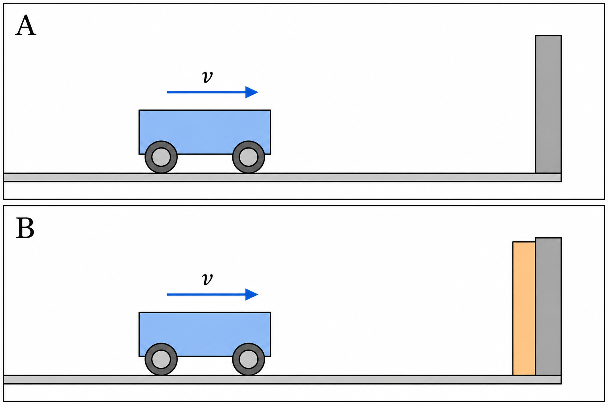
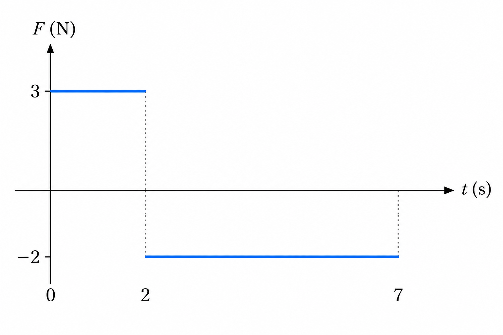

# 도판으로 익히는 풀이 전략

## 충돌 시간과 힘 시간 그래프를 함께 읽기 [10통과1-03-04]

### 1. 선개념

같은 물체를 천천히 멈추게 할 때와 갑자기 멈추게 할 때를 떠올려 보세요. 멈추었다는 결과는 같아도 멈추는 동안 받은 힘은 다를 수 있어요. 이 차이를 설명하려면 처음과 나중의 운동 상태, 힘이 작용한 시간을 따로 읽어야 해요.

**운동량:** 질량과 속도의 곱이다. 질량이 일정한 물체의 운동량 변화는 나중 운동량에서 처음 운동량을 뺀 값이다. 일직선 운동에서는 먼저 양의 방향을 정하여 속도와 운동량의 부호를 표시한다.

오른쪽을 양으로 정했다면 오른쪽 4 m/s는 +4 m/s이고 왼쪽 1 m/s는 −1 m/s예요. “4에서 1이 되었으니 3만큼 줄었다”라고 계산하면 방향이 바뀌었다는 정보를 놓쳐요. 실제 속도 변화는 −1−(+4)=−5 m/s예요.

**D-P1.** 질량 0.5 kg인 물체가 오른쪽으로 4 m/s의 속도로 움직인다. 오른쪽을 양으로 할 때 운동량을 구하시오.

**D-P2.** 위 물체가 왼쪽으로 1 m/s의 속도로 되튕긴다. 나중 운동량과 운동량 변화를 각각 구하시오.

### 2. 개념

**충격량은 물체가 받은 알짜힘을 시간에 걸쳐 누적한 양이며 운동량 변화와 같다. 평균 알짜힘을 사용하는 경우 I=F평균Δt=Δp이다.** 힘이 일정할 때는 그 일정한 힘을 그대로 사용할 수 있다. 이 장에서 ‘평균 힘’은 지정한 방향의 평균 알짜힘을 뜻한다. 단위 N·s와 kg·m/s는 같은 물리량의 단위다.

단위도 계산으로 연결해 보세요. 1 N=1 kg·m/s²이므로 여기에 1 s를 곱하면 1 N·s=1 kg·m/s가 돼요. 충격량을 시간으로 나누면 다시 N이 되어 힘의 단위가 나와요. 충격량과 운동량 변화는 같지만, 충격량과 힘은 단위부터 다른 양이에요.

그림은 충돌 직전의 모습을 나타낸 개략도예요. 벽까지 남은 거리를 재서 충돌 시간을 구하는 그림이 아니에요. 다음 표의 시간은 실제로 접촉한 뒤 멈출 때까지의 시간이에요. 수평 방향 마찰은 무시하고, 수레가 받은 수평 알짜힘을 비교해요.

| 조건 | A | B |
|---|---:|---:|
| 질량 | 0.5 kg | 0.5 kg |
| 충돌 직전 속도 | 오른쪽 4 m/s | 오른쪽 4 m/s |
| 충돌 직후 속도 | 0 | 0 |
| 접촉 시간 | 0.02 s | 0.10 s |

처음 운동량은 둘 다 +2 kg·m/s이고 마지막은 0이에요. 그러므로 Δp=0−2=−2 kg·m/s, 즉 왼쪽으로 2 N·s의 충격량을 받아요. 완충재가 있다고 해서 마지막 운동량이 0보다 더 작아지는 것은 아니에요. 여기서는 **같은 운동량 변화를 더 긴 시간에 걸쳐 만든다**는 점이 핵심이에요.

A의 평균 힘은 −2/0.02=−100 N, B는 −2/0.10=−20 N이에요. 음수는 힘이 왼쪽이라는 뜻이에요. 평균 힘의 크기는 B가 A의 1/5이지만, 충격량의 크기는 같아요. 시간의 다섯 배 증가와 평균 힘의 1/5 감소가 곱해져 같은 충격량을 만들어요. 이 계산만으로 순간 최대 힘까지 구할 수는 없어요.

### 3. 개념평가

**D-C1.** 표의 A와 B가 받은 충격량의 크기를 각각 구하시오.

**D-C2.** A와 B가 받은 평균 힘의 크기와 방향을 각각 구하시오.

**D-C3.** “완충재는 충격량을 1/5로 줄였다.”라는 설명의 잘못을 지적하고, 같은 자료에 맞는 문장으로 고치시오.

### 4. 심화개념

<!-- FIGURE:REF-07 -->

같은 결론을 새 조건에 적용하기 전에 무엇이 같았는지 되짚어 보세요. 앞에서는 질량, 처음 속도, 마지막 속도가 같았어요. B의 수레만 되튕기면 마지막 운동량이 달라져요. 충돌 시간이 길다는 사실만으로 충격량이 같다고 말할 수 없어요.

이번에는 아래 그래프를 읽어 봐요. 질량 2 kg인 물체가 t=0에서 오른쪽 1 m/s로 움직여요. 오른쪽을 양으로 정하고, 그래프는 물체에 작용한 수평 알짜힘을 나타내요. 그림은 개략도이며 정확한 구간과 값은 표와 눈금으로 확인해요.

| 시간 구간 | 수평 알짜힘 |
|---|---:|
| 0≤t<2 s | +3 N |
| 2≤t≤7 s | −2 N |

이 그래프의 높이는 운동량이 아니라 힘이에요. 운동량 변화를 얻으려면 힘과 시간을 곱해야 해요. 첫 구간의 충격량은 (+3)×2=+6 N·s예요. 둘째 구간은 (−2)×5=−10 N·s예요. 따라서 전체 충격량은 +6−10=−4 N·s예요. 두 직사각형 넓이의 절댓값 6과 10을 무조건 더하면 힘의 방향을 지워 버리게 돼요.

처음 운동량은 +2 kg·m/s예요. 2 s에서는 +2+6=+8 kg·m/s, 7 s에서는 +8−10=−2 kg·m/s예요. 마지막 속도는 −2/2=−1 m/s, 즉 왼쪽 1 m/s예요.

2 s에서 힘이 왼쪽으로 바뀌었다고 물체가 그 순간부터 왼쪽으로 움직이는 것은 아니에요. 그때는 아직 오른쪽 운동량 +8이 남아 있어요. 1초마다 2 N·s씩 왼쪽 충격량을 받으므로 +8을 없애는 데 4초가 걸려요. 따라서 6 s에서 잠깐 정지하고, 그 뒤에는 왼쪽으로 움직여요. **힘의 방향은 운동량이 변하는 방향이고, 속도의 방향은 그때 운동량의 방향**이라는 차이를 기억해요.

같은 과정을 시점별로 나란히 놓으면 그림의 힘과 물체의 운동을 구별하기 쉬워요. 아래 표의 운동량은 **처음 운동량에 그때까지의 부호 있는 충격량을 더한 값**이에요.

| 시각 | 처음부터 누적한 충격량 | 운동량 | 그 순간의 운동 상태 |
|---|---:|---:|---|
| 0 s | 0 N·s | +2 kg·m/s | 오른쪽 1 m/s |
| 2 s | +6 N·s | +8 kg·m/s | 오른쪽 4 m/s |
| 6 s | +6−8=−2 N·s | 0 kg·m/s | 순간적으로 정지 |
| 7 s | +6−10=−4 N·s | −2 kg·m/s | 왼쪽 1 m/s |

힘이 커지는 순간에는 운동량이 더 빠르게 변할 수 있어요. 그러나 **힘의 높이가 가장 큰 순간과 운동량의 크기가 가장 큰 순간은 같은 뜻이 아니에요.** 운동량을 판단할 때는 그 순간의 그래프 높이가 아니라 출발 이후 누적된 넓이를 처음 운동량에 더해야 해요. 한 방향의 힘이 계속 작용하는 충돌이라면 부호 있는 운동량은 그 힘의 방향으로 계속 변해요. 되튕기는 동안 운동량이 0을 지나면 크기는 줄었다가 다시 커질 수 있으므로, 최대 힘 시각만으로 운동량 크기의 최댓값을 고를 수 없어요.

### 5. 심화평가

**D-A1.** 개념 단계의 수레–완충재 그림 IMG-001과 조건표에서 B 실험만 바꾼다. 질량·충돌 직전 속도·접촉 시간은 같지만, 수레가 충돌 후 왼쪽 1 m/s로 되튕겼다. B가 받은 충격량과 평균 힘을 부호를 포함하여 구하시오. 이때 B의 평균 힘 크기가 여전히 A의 1/5인지 판단하시오.

**D-A2.** 심화개념의 수평 알짜힘 표(0~2 s: +3 N, 2~7 s: −2 N)에 제시한 실험에서 2 s와 7 s의 운동량을 각각 구하고, 물체가 처음으로 정지하는 시각을 구하시오. “2 s부터 힘이 음수이므로 2 s부터 왼쪽으로 움직인다.”라는 설명을 반박하시오.

### 6. 수능대비 전략

이런 문제는 공식을 기억하는지만 묻지 않아요. 같은 기호라도 그래프의 세로축이 힘인지, 운동량인지, 속도인지 구분하는지 확인해요. 힘 그래프의 높이를 운동량으로 읽으면 계산을 정확히 해도 출발점부터 틀려요.

풀이를 시작할 때는 **축과 단위 → 양의 방향 → 처음 운동량 → 구간별 충격량 → 나중 운동량** 순서로 메모해 보세요. 힘이 반대 방향인 구간에서는 넓이의 부호를 유지해요. 여러 시점의 속력을 비교할 때도 먼저 각 시점의 운동량을 구한 뒤 절댓값으로 속력을 구해요.

“충돌 시간이 길수록 힘이 작다”라는 전략에는 같은 운동량 변화라는 조건이 붙어요. 되튕김의 정도, 질량, 처음 속도가 달라졌다면 다시 계산해야 해요. “힘이 음수이면 물체가 왼쪽으로 움직인다”는 전략은 사용할 수 없어요. 오른쪽으로 움직이면서 속력이 줄어드는 상황이 반례예요.

### 7. 수능대비평가

**D-S1. 자작 수능형 연습.** 심화개념의 수평 알짜힘 표(0~2 s: +3 N, 2~7 s: −2 N)의 조건에서 옳은 것만을 있는 대로 고른 것은?

ㄱ. 0~7 s 동안 물체가 받은 충격량은 −4 N·s이다.

ㄴ. 2~6 s 동안 물체는 계속 왼쪽으로 이동한다.

ㄷ. 7 s에서 물체의 속력은 1 m/s이다.

① ㄱ　② ㄴ　③ ㄱ, ㄷ　④ ㄴ, ㄷ　⑤ ㄱ, ㄴ, ㄷ

**D-S2. 자작 수능형 연습.** 심화개념의 수평 알짜힘 표와 같은 힘(0~2 s: +3 N, 2~7 s: −2 N)이 질량 2 kg인 물체에 작용한다. 처음 속도만 바꿀 수 있을 때 옳은 설명은? 오른쪽을 양의 방향으로 한다.

① 처음에 오른쪽 1 m/s로 움직이면 7 s까지 운동 방향이 바뀌지 않는다.

② 처음에 오른쪽 2 m/s로 움직이면 7 s에서 정지한다.

③ 2 s 이후에는 처음 속도와 관계없이 물체가 왼쪽으로 움직인다.

④ 0~7 s의 충격량은 처음 속도가 클수록 커진다.

⑤ 0~7 s의 충격량 크기는 두 직사각형 넓이의 절댓값을 합한 16 N·s이다.

### 정답과 해설

**D-P1. +2 kg·m/s.** p=mv=0.5×(+4)이다. 숫자 2만 쓰지 말고 단위와 방향까지 확인한다. 질량과 속도의 단위가 다른 자료라면 먼저 kg, m/s로 맞춘다.

**D-P2. 나중 운동량 −0.5 kg·m/s, 변화 −2.5 kg·m/s.** 나중 값은 0.5×(−1), 변화는 −0.5−(+2)이다. 1.5라고 썼다면 나중 운동량의 방향을 지웠는지 확인하고 선개념의 부호 설명으로 돌아간다.

**D-C1. 둘 다 2 N·s.** 각각의 처음·나중 운동량이 같으므로 Δp도 같다. 접촉 시간만 보고 서로 다른 충격량이라고 판단했다면 I=Δp부터 확인한다.

**D-C2. A는 왼쪽 100 N, B는 왼쪽 20 N.** 같은 충격량의 크기 2를 각 접촉 시간으로 나눈다. 0.10 s는 0.02 s의 다섯 배이므로 B의 평균 힘은 A의 1/5이다. 음의 평균 힘을 음의 ‘크기’라고 쓰지 않는다.

**D-C3. 충격량은 같고 평균 힘의 크기가 1/5이 되었다.** 처음과 나중의 운동량이 같은 두 실험을 비교하기 때문에 가능하다. ‘완충재가 있으면 언제나 충격량이 같다’로 조건을 확대하지 않는다.

**D-A1. 충격량 −2.5 N·s, 평균 힘 −25 N.** 나중 운동량은 −0.5, 처음은 +2이므로 차이는 −2.5이다. 이를 0.10 s로 나누면 −25 N이다. A의 평균 힘 크기는 100 N이므로 B는 1/4이다. 1/5이라고 했다면 충돌 후 속도가 바뀐 조건을 반영했는지, 두 힘을 나누는 계산이 맞는지 순서대로 확인한다.

**D-A2. +8 kg·m/s, −2 kg·m/s, 6 s.** 첫 구간의 충격량 +6을 처음 운동량 +2에 더한다. 이어 −2 N이 5초 작용하면 −10 N·s가 추가된다. 정지까지 필요한 왼쪽 충격량은 −8 N·s이고, 4초가 걸리므로 2+4=6 s이다. 2~6 s에는 오른쪽 운동량이 점점 작아질 뿐, 아직 왼쪽 운동량이 아니다.

**D-S1. ③.** ㄱ은 +6−10=−4이므로 참이다. ㄴ은 2 s에서 운동량이 +8이고 6 s에 0이 되므로 거짓이다. ㄷ은 마지막 운동량 −2를 질량 2로 나눈 속도가 −1 m/s이므로 참이다. ①은 참인 ㄷ을 빠뜨리고, ②는 거짓인 ㄴ만 고른다. ④·⑤도 거짓인 ㄴ을 포함한다. 방향 판정이 틀렸다면 심화개념의 2~6 s 설명을 다시 읽는다.

**D-S2. ②.** 처음 운동량이 +4이면 전체 충격량 −4를 더한 마지막 운동량은 0이다. ①은 처음 운동량 +2에서 마지막 −2로 부호가 바뀌므로 거짓이다. ③은 음의 힘과 음의 속도를 혼동한다. ④는 주어진 힘과 작용 시간이 같으므로 충격량은 처음 속도와 무관하게 같다. ⑤는 서로 반대인 충격량을 부호 없이 더했다. 문제의 조건에서 그래프 자체가 같다는 점을 확인한 뒤 전략을 적용한다.

### 편집자 출처 기록

첫 번째 그림은 신규 제작이다. 특정 교재 도판을 수정한 것으로 표시하지 않는다. 새로 제작한 힘 시간 그래프 IMG-002는 동아출판 하이탑 통합과학1권 인쇄 170쪽 30번(PDF 분할 파일 162~175, PDF 9쪽)의 힘 시간 그래프와 평가 개념을 참고하여 재구성하였다. 원문의 한 방향으로 감소하는 힘·처음 정지·속력비 질문을, 부호가 바뀌는 일정 힘·처음 운동량 존재·정지 시점과 방향 판단으로 바꾸었다. 원문의 지문·선지는 수록하지 않았다. 원본 그래프 REF-07은 재제작 참고용으로 함께 수록했으며, 변형 문제는 새 그래프 IMG-002와 수평 알짜힘 표를 기준으로 푼다. 도판 전체 프롬프트와 변경 지시는 별도 제작 기록에 보존한다. D-S1과 D-S2는 평가원 원문이 아닌 자작·재구성 연습문항이다.
